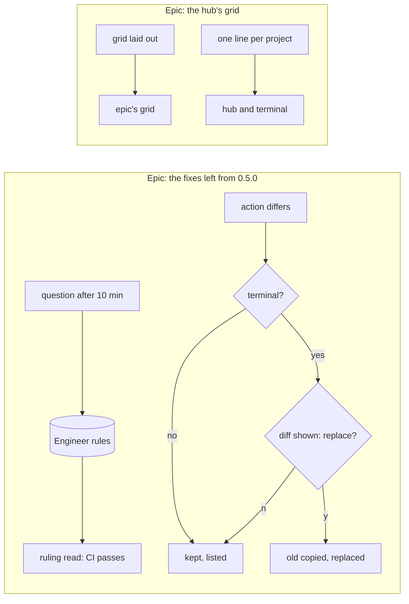

# Release 0.5.1 design: the fixes left from 0.5.0, and the hub's grid

2026-11-18 · The Designer, from the signed `scope.md` · **Draft until the Engineer signs it.**

## Summary

0.5.1 does four small things, each from the scope:

1. **A pull request with no check is raised in minutes, and a ruling lets it go on (#144).** Today zaf waits two hours, then asks, and even after the Engineer rules the task never moves. The design gives "no check at all" a short deadline of its own (10 minutes), says in the question which file the pull request changes, and lets a ruling on that question count the checks at that commit as passed.
2. **`zaf setup` shows the difference and asks before it replaces an installed action (#149).** For each machine action that differs from the pack's, setup prints `git diff --no-index` between the two and asks `replace? [y/N]`. With no terminal it keeps the old file, as today, and says which ones differ.
3. **The hub's squares sit in a uniform grid.** Same squares, same colours, hover and click. They now fill top to bottom down a column, then the next column, with one even gap everywhere, as GitHub's contribution grid does. Up to 7 rows, always fewer rows than columns.
4. **The "run `zaf profile init`" messages say it once per project, and an upgrade stops causing them.** Today the hub's Next for you shows one item per stale profile. Four listed projects hold profiles that are stale (8 items). Worse, any new zaf makes every profile stale, so each upgrade brings them all back. The design gives each project one item. A profile then goes stale only when what zaf writes into it changes (Q14), not on every new zaf.

Nothing on the board or in the manifest changes shape; only a profile's local stamp gains a field (Q14). There is no one-way door; the closest is a new question marker that boards will hold (see One-way doors).
Two epics: **the fixes left from 0.5.0** (parts 1 and 2) and **the hub's grid** (parts 3 and 4, the UI work the Engineer wants to sign on its own).
**Questions for the Engineer: 14 (Q1 to Q14), all answered on 2026-11-18.** Q7 and Q11 in the Engineer's own words. The other twelve as pre-filled: "All stand", and for Q14, "A generation number". None open. Q13 and Q14 came from the fresh challenge.

## What this builds on

The input is `scope.md` (signed 2026-11-18). 0.5.1 has no objectives document: the Engineer chose a small release over an interview. So the goals below trace to the scope's four bullets, not to objectives.

| Goal | From the scope | Done when |
|---|---|---|
| G1 | "A task whose pull request gets no check is raised, not left waiting two hours (#144)" | A task whose pull request gets no check has a question within about 15 minutes. A ruling on it moves the task on to review. |
| G2 | "`zaf setup` asks before it overwrites an installed action, and shows the difference (#149)" | Run in a terminal on a machine whose `design` action is older than the pack's, setup shows the difference, asks, and replaces it on `y`. On `n`, Enter or closed input it keeps the old one. |
| G3 | "The hub's squares in a uniform grid", checked as the 0.6.0 objectives' Out of scope row says | The scope's check holds: an N by M grid, wider than tall, with uniform spacing like GitHub's contribution grid. Squares run top to bottom down a column, and colours, hover and click work as today. |
| G4 | "The repeated `zaf profile init` messages left from 0.4.3" | The hub's Next for you holds at most one stale-profile item per project. After installing a zaf that writes profiles the same way, none appears (if Q14 stands). |

**Out**, carried from the scope: everything of 0.6.0 (the git adapter, the Jira and zabo boards, signing and design where the project says), and a model reporting where it is to the hub.
Also out: **a better UI for zaf**, beyond the grid and the one stale-profile item. The Engineer, 2026-11-18: "Take note that 0.6.1 will include a better UI for zaf, please."

## Questions for the Engineer

Each question has options, the first marked as Claude's pick, then **Claude's answer** with its evidence.

**The Engineer (2026-11-18):** Q7 and Q11 as quoted under each. Every other pre-filled answer stands ("All stand"), Q14 as (a), "A generation number". So each question's Claude's pick is the ruling.

### No check at a head (#144)

**Q1. How soon is a head with no check at all raised?**
- (a) **(Recommended)** After a deadline of its own, 10 minutes from when the wait began. Pending checks keep their two hours.
- (b) After `[check] ci_grace_seconds` (120 s by default), the grace `zaf check` already uses.
- (c) A new manifest key, `[check] no_check_minutes`.

**Claude's answer:** (a). A question makes its ticket wait until it is ruled (`zaf/src/app/schedule/ask.rs:1-5`). So a question raised before a slow forge lists its checks would hold a ticket that was about to pass. Two minutes is too tight for that. Ten minutes is two ticks at the default five minutes (#421 ruling 25, `docs/zaf-actions.md:448`; the length is `[spawn] tick_minutes`). So the question arrives 10 to 15 minutes after the pull request opens, not 2 hours after. It stays a constant, as `CHECK_DEADLINE` is (`zaf/src/domain/schedule/wait.rs:23`).

**Q2. What can the Engineer's ruling do?**
- (a) **(Recommended)** The ruling lets the task go on at that commit with no check: the CI phase counts as passed there. A new commit starts the clock again and, with no check again, asks again.
- (b) The same, but for every later commit of that task that gets no check either.
- (c) Nothing new: the ruling only records the answer, as today.

**Claude's answer:** (a). It is the way R29 already settles the integration branch: a ruled `Base deadline: <head>.` lets the merge through at that head (`zaf/src/app/schedule/gather.rs:342-360`). It is also what `zaf check` already does: after its grace, an empty check list is clean, "a pull request that triggers no workflow stays mergeable" (`zaf/src/app/check/step/ci.rs:3-5`). So review and merge pass today. Only the scheduler's CI phase waits for ever, because "no check at all has not ended" (`zaf/src/domain/schedule/facts.rs:202-210`). (b) saves a question after each fix push, but it would also pass a later commit whose workflow was meant to run and did not. One limit, not checked: a forge whose branch rule requires status checks may still refuse to merge a pull request with none. ways has no such rule on its integration branch; a work forge may (0.6.0's concern).

**Q3. How does the Engineer learn that a path filter skipped the change?**
- (a) **(Recommended)** The question names a file the pull request changes (the forge already gives one, `Forge::last_changed_file`). Then the Engineer sees at once that it is outside the filter.
- (b) `zaf doctor` reads the workflows' `paths:` filters and warns about folders they leave out.
- (c) Neither.

**Claude's answer:** (a). Tasks state scope in words, not files (the planning template, `plugins/teams/agents/planning.md:96`). So there are no "task's paths" to check ahead of time, only the pull request's files once it opens. (b) needs a YAML reader, which zaf does not have (`zaf/Cargo.toml`), and the same lack rules out a warning in `zaf check`, which the scope also names. It would also need the path-filter rules of GitHub and Forgejo, which this design has not checked (unverified). That is more than a small release.

### Setup replaces an action only when asked (#149)

**Q4. How is the difference shown?**
- (a) **(Recommended)** zaf compares bytes and mode itself, and only for a file that differs runs `git diff --no-index --no-ext-diff --no-color` to show the difference. With no `git` on the machine, or output that is not a diff, setup keeps the old file and says it could not show the difference.
- (b) A line diff written into zaf.
- (c) A diff crate added as a dependency.

**Claude's answer:** (a). It is the Engineer's own idea ("we may use a git tool or something for this", the ruling on #107). git only shows the difference; it does not decide it. zaf's shell port reports only pass or fail (`zaf/src/ports/gate.rs:29-43`), and git exits 1 both for "different" and for some errors (checked with git 2.56.0: `git diff --no-index -- x missing` exits 1). (b) is about a hundred lines to test; (c) adds a dependency.

**Q5. What happens with no terminal (an instance, a pipe, `ZAF_INSTANCE` set)?**
- (a) **(Recommended)** Setup keeps every installed action, as today, and prints one line naming those that differ from the pack's, with "run `zaf setup` in a terminal to review them".
- (b) It refuses (exit 1) while any differs.

**Claude's answer:** (a). A model must never answer the question, and a refusal would fail every non-interactive setup on a machine that keeps its own edits on purpose. The one line says what is waiting.

**Q6. What happens to the file that is replaced?**
- (a) **(Recommended)** It is kept as `~/.zaf/actions-replaced/<name>.<UTC time>`, and setup's line says where.
- (b) It is gone. The diff on screen was the record.

**Claude's answer:** (a). The machine tier is not under version control, and its files are sometimes edited by hand: dapple's actions were copied in by hand after pack changes, with old copies kept in `~/.zaf/actions-backup-0.3.1`. A copy costs one file per replacement and makes a wrong `y` harmless.

### The hub's grid

**Q7. What does a square stand for, now that a task's squares are no longer grouped?**
- (a) **(Recommended)** As today, a unit of size: XS 1, S 2, M 3, L 4, XL 5, E 6, a task with no size 2. Hovering any square of a task shows its card and outlines the task's other squares.
- (b) One square per task, whatever its size.
- (c) One square per phase of the task (four for implement, ci, review, merge).

**Claude's answer:** (a). The Engineer defined the line as "each task taking a variable amount of squares based on how big the task is" (epic #115), and the scope's check says "only the layout changes". The outline is the one addition: without the old gaps, it is the only way to see which squares are one task.

**The Engineer (2026-11-18):** (a), with the outline: "Yes, they should".

**Q8. Where do a task's squares start?**
- (a) **(Recommended)** Right after the previous task's last square, so a task may run on from the bottom of one column to the top of the next.
- (b) At the top of a new column for every task.
- (c) At the top of a new column only when the task does not fit in what is left of the current one.

**Claude's answer:** (a). It is the only one with no holes, so the grid is uniform ("Every square sits the same distance from its neighbours and none are grouped by task"). (b) and (c) leave empty cells that read as gaps between tasks.

**Q9. How many rows?**
- (a) **(Recommended)** The most rows, up to 7, that still leaves fewer rows than columns. 12 squares make 3 by 4, 50 make 7 by 8, 120 make 7 by 18. Wider than the page, the grid scrolls sideways inside its own box.
- (b) Always 7, as GitHub's grid.
- (c) As many columns as fit the page width, and rows as needed.

**Claude's answer:** (a). (b) makes a small epic taller than wide (12 squares are 7 by 2), against the check's "N (rows) < M (columns)". (c) makes the grid tall on a phone. Seven is GitHub's count (a week per column).

**Q10. Where do the epic's own squares go?** Today an epic's line starts with two squares for the epic itself, set apart by a wider gap (`zaf/web/src/app.css:315-317`).
- (a) **(Recommended)** One square beside the epic's title, outside the grid, with the same colours, hover and click as today.
- (b) Its two squares stay first in the grid, spaced like the rest.

**Claude's answer:** (a). In a uniform grid, the epic's squares would look like a task's. Beside the title it still shows the epic's state and still opens its question. It joins the finish: it shines last, after the grid's wave.

**Q13. One grid per epic, or one for the whole project?** (from the challenge)
- (a) **(Recommended)** One per epic, as the line is today. Each epic keeps its title, its square and its "n of m done".
- (b) One grid for all of a project's open epics, like GitHub's single grid.

**Claude's answer:** (a). The check says "its squares form an N by M grid" and does not settle it. Per epic keeps what an epic's line already means ("how close to finishing we are", epic #115). One grid would mix epics with no way to tell where one ends but the hover.

### The profile messages

**Q11. How should the stale-profile messages change?** Found on this machine: dapple, zabo and learning hold `build` and `lean` profiles stamped by zaf 0.4.3, and zurfur's have no stamp. The hub makes one Next-for-you item per stale profile (`zaf/src/app/hub/state.rs:424-430`, `next.rs:264-292`), so that is eight "cannot run" items with four fixes.
- (a) **(Recommended)** One item per project: "dapple cannot run: profiles build and lean are older than zaf (written by zaf 0.4.3)", one fix. `zaf doctor`, `status` and `spawn` print the same one line.
- (b) (a), and zaf regenerates a profile by itself when the only reason is that an older zaf wrote it.
- (c) (a), and a hub button that runs `zaf profile init` for the project.

**Claude's answer:** (a). It ends the repetition with no new behaviour. (b) takes away the message entirely, but `profile init` runs Claude's plugin commands, and the stamp exists so a stale profile is never silent (`docs/zuri-ai-framework.md`, "A profile carries its stamp"). (c) is a new control behind the hub's key, more than a small release.

**The Engineer (2026-11-18), on where it shows:** "Yes, exactly there. The website was showing me the spam." A better UI for zaf as a whole is for 0.6.1 (see Out).

**Q14. Should a new zaf still make every profile stale?** (from the challenge) A profile's stamp records which zaf wrote it, and any other zaf counts it as stale for that alone (`zaf/src/app/profile/stamp.rs:222-224`). So installing 0.5.1 turns every project's profiles stale again, ways' own included, and the items come back, one per project.
- (a) **(Recommended)** The stamp records a **generation number** that zaf's code raises only when what `profile init` writes changes (the settings, the denies, the pack step). A new zaf with the same number and matching inputs leaves the profiles current. A test fails when the generated profile for a fixture manifest changes and the number was not raised, so it cannot be forgotten.
- (b) Keep the zaf version in the stamp; the design only says that every upgrade brings one item per project.
- (c) zaf regenerates a profile itself when the only reason is an older zaf: the scheduler before a tick, and `zaf setup`.

**Claude's answer:** (a). The stamp is there so that "a stale profile ran instances with yesterday's deny list" is never silent (`docs/zuri-ai-framework.md`, "A profile carries its stamp"). What makes a profile stale is what zaf writes into it, not which zaf wrote it, so (a) keeps that guard and drops the false alarms. Stamps written before 0.5.1 have no number and are stale once more, the last time for an upgrade that changes nothing. (c) hides the item for projects that tick, but not for idle ones like dapple and zabo, and it runs Claude's plugin commands with no one asking.

### The epics

**Q12. How many epics?**
- (a) **(Recommended)** Two: **the fixes left from 0.5.0** (#144, #149) and **the hub's grid** (the grid and the profile messages).
- (b) Three: #144, #149 and the hub apart.
- (c) One for all of it.

**Claude's answer:** (a). The Engineer asked to sign the hub's UI on its own ("if I can sign the epic for that as well. All the UI changes may go there"). The profile messages travelled with the UI in the 0.6.0 objectives, and in the hub that is where they show. The two fixes are each small. Planning splits each epic into tasks anyway.

## The design

<b>Part A. No check at a head (#144): modules and interfaces</b>

**Today.** A task in the `ci` phase waits on the checks at its pull request's head (`TicketFacts::awaited_checks`, `zaf/src/domain/schedule/facts.rs:419-427`). No check at all counts as not ended, so it waits. After `CHECK_DEADLINE` (2 h, `wait.rs:23`) the tick asks: "No check has registered at … It waits on its checks until one ends there" (`ask.rs:450-454`), marker `Check deadline: <head>.`. The ruling changes nothing; the marker is asked once per head, so the task then waits in silence for good.

**After.**

| Id | Module (file) | Change |
|---|---|---|
| M1 | The scheduler's waits (`zaf/src/domain/schedule/wait.rs`) | A second constant `NO_CHECK_DEADLINE` (10 min, Q1). `overdue` uses it when what is awaited is `Awaited::NoCheck`, and `CHECK_DEADLINE` otherwise. |
| M2 | Ticket facts (`zaf/src/domain/schedule/facts.rs`) | `TicketFacts` gains `no_check_ruled: Option<CommitId>`: the head a ruled no-check question names. `awaited_checks()` is none when the head has no check and equals `no_check_ruled`. |
| M3 | Phase ends (`zaf/src/domain/schedule/phase.rs`) | `PhaseEnd::CiDone` holds at a head with no check that `no_check_ruled` names. It is timed so the time never moves: the latest end, at that head, of a run of a phase listed before `ci`, or else the pull request's opening. (`check_clock` would move when review's run ends, `wait.rs:66-79`.) A head with checks still needs them all passed. |
| M4 | The questions (`zaf/src/app/schedule/ask.rs`) | A no-check wait gets its own marker, `No check: <head>.` (Q2). Its text and its one-line summary (`Cause::line`) give the wait in minutes, since `hours()` rounds down to whole hours (`ask.rs:146`). The text names a file the pull request changes, in a code span (Q3: a model wrote the name, and an `@name` on a Forgejo issue would notify someone). It ends: "Once this is ruled, it goes on at that commit with no check." Pending checks and outside waits keep `Check deadline: <head>.` and their text. |
| M5 | The gather (`zaf/src/app/schedule/gather.rs`) | In `read_ticket` (line 567), for a ticket whose head has no check, it reads the ticket's ruled questions for `No check: <head>.` and sets `no_check_ruled`. It has to be there, not beside `ruled_through` in the merge pass (lines 342-360): `gather_one`, which every phase launch runs (`zaf/src/app/spawn/phase.rs:163, 352`), stops before that pass for a ticket not at its merge (`gather.rs:467-474`). Then the tick, a phase's launch, `zaf status` and the hub all see the ruling. Tickets with checks are not read, so most gathers read nothing new. |

**Interfaces.**
- **I1** `pub const NO_CHECK_DEADLINE: Duration` beside `CHECK_DEADLINE`. `overdue(facts, now) -> Option<OverdueCheck>` keeps its signature.
- **I2** `pub fn no_check_marker(head: &CommitId) -> String`, returning `No check: <head>.` in full, as `base_deadline_marker` does.
- **I3** `TicketFacts::no_check_ruled: Option<CommitId>`, set only by the gather. About ten places build `TicketFacts`; planning may group it into a small struct with a default, as `MergeFacts` is, so they change once.
- **I4** The pull request's facts keep the file the forge names (today only `changes_a_file: bool`, `gather.rs:718`), so the question can name it: `changed_file: Option<RepoPath>`, a new newtype in the domain beside `PageId` and `Quote` (none exists for a path yet), with `changes_a_file()` as `changed_file.is_some()`. About fourteen places build `PullFacts`.

**Edge cases.** If a check registers after the question is raised, the task still waits on the open question until it is ruled, as with every question today. A ruling on an old head does nothing at a new one. A head whose checks are pending is never passed by this ruling.

**Documents.** What `ci-done` means changes, so these say it: `docs/zaf-actions.md:220` ("one of four the forge answers"), `:233` ("none registered counts as not ended"), `:243`, and the doc comments at `zaf/src/domain/schedule/phase.rs:36, 201`. §5.1's table of questions (line 267) gains the no-check row with its marker. R19 in `zaf/memory/decisions/scheduler-rulings.md` says what the ruling does, and the deadline row of `zaf/memory/roadmap/open-decisions.md` says 10 minutes for no check.

<b>Part B. Setup replaces an action only when asked (#149): modules and interfaces</b>

**Today.** `install_pack_actions` copies each pack action the machine tier lacks, and leaves the others byte for byte (`zaf/src/app/setup.rs:350-411`, `copy_new` at 413). It prints "kept the machine's own, unchanged: …". A machine with an old `design` action keeps it.

**After.**

| Id | Module (file) | Change |
|---|---|---|
| M6 | Setup's action install (`zaf/src/app/setup.rs`) | An installed action that is a regular file and whose bytes or mode bits differ from the pack's is offered for replacement. zaf compares them itself. Setup gets the difference to show (I6), asks (I5), and on yes copies the old one aside (Q6) and puts the pack's in place: written to a temporary file and renamed over, so a reader never sees half a file. Equal files are kept silently, as today. A machine-tier name that is a link, a folder or anything but a regular file is never offered, so a linked action is never replaced. |
| M7 | Setup's terminal (`zaf/src/cli/setup.rs`) | The asker reads the Engineer's answer on the terminal: `y` replaces; anything else, Enter or closed input keeps. It exists only when `this_terminal()` holds (`zaf/src/cli/do_action.rs:169`, stdin and stdout both a terminal) and `ZAF_INSTANCE` is unset (Q5). Init's questions, asked in a folder with no manifest, keep reading stdin as today. |

**Interfaces.**
- **I5** An app-layer port, `trait ReplaceAction { fn replace(&mut self, name: &str, difference: &str) -> bool; }`. `setup` takes `Option<&mut dyn ReplaceAction>`. The CLI's terminal adapter prints the difference and the question; tests use a fake that answers from a list.
- **I6** `fn differs(installed: &Path, pack: &Path) -> io::Result<bool>` compares bytes and mode bits in Rust. Only for a file that differs, `fn difference(commands: &dyn Commands, installed: &Path, pack: &Path) -> Option<String>` runs `git diff --no-index --no-ext-diff --no-color -- <installed> <pack>` through `Commands`, which setup already takes and which reports a missing program as not found (`zaf/src/cli/doctor.rs:36-56`). It returns the text only when it is a diff (it opens with `diff --git`); a missing `git` or any other output is `None`, and setup keeps the file and says it could not show the difference (Q4). A mode change shows in git's header (`old mode` / `new mode`, checked with git 2.56.0). Whether `diff.external` applies to `--no-index` is not checked; `--no-ext-diff` covers it either way.
- **I7** `PackActions` gains `replaced: Vec<(String, PathBuf)>` (name, where the old copy went) and `differs: Vec<String>` (kept though it differs). `lines()` prints `replaced design (the old one is at ~/.zaf/actions-replaced/design.20261118T091500Z)`, and for no terminal `differs from the pack, kept: design; run zaf setup in a terminal to review`.

**Unchanged.** A project's own `.zaf/actions/` is never touched (#149: "A project with its own copy of the action in `.zaf/actions/` is not touched by this"). Folders, links and `hooks/` are skipped as today. Nothing is deleted. Only `zaf setup` (`zaf/src/cli/setup.rs:137`) calls this; other verbs run only `ensure_homes`. About 15 unit tests that call `setup_with` (`zaf/src/app/setup/tests.rs`) take the new argument. The integration tests run the binary with no terminal, so they take the no-terminal path.

**Documents.** These say it asks before replacing: `docs/zaf-actions.md:38` (§2, today "never over a file already there, so an action the Engineer edited is left byte for byte") and §4's row on `setup` (line 129).

<b>Part C. The hub's grid: modules and interfaces</b>

**Today.** `EpicLine.svelte` draws an epic as a flex row that wraps: the epic's two squares, a wider gap, then each task's run of squares, 1 px apart inside a task and 0.25 rem between tasks (`zaf/web/src/app.css:297-317`). That grouping is what the Engineer called ugly.

**After.**

| Id | Module (file) | Change |
|---|---|---|
| M8 | The grid's arithmetic (`zaf/web/src/line.js`) | Pure functions: how many rows for a number of squares (Q9), and each square's column and row when the squares run down each column in task order (Q8). |
| M9 | The epic's line (`zaf/web/src/EpicLine.svelte`, `zaf/web/src/app.css`) | The squares become cells of a CSS grid that fills by column, with one gap everywhere. The epic's square moves beside its title (Q10). Hover and focus on any of a task's squares show its card as today and outline its other squares (Q7, the Engineer: yes). Focus and hover follow I10, because a task's squares may now sit in two columns and no one box can wrap them (today one `<li>` and one link or button wrap them, and the card hangs from that `<li>`, `EpicLine.svelte:243-275, 146-166`). Colours, motion, the finish wave (now running down the columns, in the squares' order, the epic's square last), the prompt, the count and the legend stay. A working task's squares still fill one after another. Past the page's width the grid scrolls sideways in its own box. |
| M10 | The build (`zaf/web/dist/`) | Rebuilt and committed with the source, as the page's README says. |

**Interfaces.**
- **I8** `gridRows(squares: number): number` returns the most rows `n`, 1 to 7, with `n < ceil(squares / n)` (1 when there is one square). `gridCells(tasks) -> [{ task, index, column, row }]` lays out the squares in task order, a task's squares in a row of the list, column-major.
- **I10** Each square is its own cell of the grid. A task's **first** square is its one focusable element: the link to its issue, or the button that opens its prompt, as today. It carries the task's accessible name. The task's other squares are hidden from screen readers (`aria-hidden`) and are not in the tab order. A pointer on them shows the card, outlines the task and clicks through to the same place. The card hangs from the square under the pointer, or from the first square when focus brings it. The ordered list stays in the page for reading order. `display: contents` is not used: it would give the card a box of no size, and it has had accessibility faults on links and buttons (unverified, so not relied on).
- The hub's JSON does not change: the page already has each task's size, state, phases and card fields (epic #115 §5).

**Tests.** jsdom computes no layout, so the tests check the arithmetic and what each square is told, not how it looks; how it looks is the Engineer's own check (G3).
- New: `gridRows` and `gridCells` (12 squares make 3 rows and 4 columns, 50 make 7 by 8, 1 makes 1 by 1; squares go down each column; a task runs on into the next column). Each square gets its row and column. One focus stop per task. Hovering one square of a task outlines the rest. The epic's square sits beside the title, not in the grid.
- Changing: the tests that count two epic squares and that start the finish wave at the epic's block (`EpicLine.test.js:31, 434-437`), and any that read the card's place from the task's `<li>`.
- Kept: the colours, the card's fields, the prompt and its answer, reduced motion.

<b>Part D. One stale-profile line per project: modules and interfaces</b>

**Today.** `StaleProfile::line` gives one sentence per profile (`zaf/src/app/profile/stamp.rs:158-183`). The hub adds one problem for each, each with the same fix, `cd <root> && zaf profile init` (`zaf/src/app/hub/state.rs:424-430`). Next for you turns each problem into a "cannot run" item (`zaf/src/app/hub/next.rs:264-292`). `zaf doctor`, `status` and `spawn` print one line each.

**After.**

| Id | Module (file) | Change |
|---|---|---|
| M11 | Profile stamps (`zaf/src/app/profile/stamp.rs`, `zaf/src/app/profile/mod.rs`) | One sentence for all of a project's stale profiles, grouped by reason: "profiles build and lean are older than zaf (written by zaf 0.4.3)". With several reasons it joins them: "profile build has no stamp; profile lean is older than the manifest (forbidden changed)". With Q14 (a): the stamp also records the generation number, and a stamp from another zaf is stale only when its number differs or a digest does (`stamp.rs:222-224` today: any other zaf version). |
| M12 | The hub's state, doctor, status and spawn (`zaf/src/app/hub/state.rs`, `zaf/src/app/doctor.rs`, `zaf/src/app/status.rs`, `zaf/src/cli/spawn.rs`) | Each uses the one sentence: one problem, one fix, one line. |

**Interfaces.**
- **I9** `pub fn stale_line(stale: &[StaleProfile]) -> Option<String>`, none for an empty list. `StaleProfile::line` stays for callers that want one profile.
- **I11** (Q14 a) `pub const GENERATION: u32` in the profile module. The stamp's JSON gains `"generation": <n>`. `Reason` gains `Generation(old)`, worded "written by an older profile generation (zaf <old>)". A stamp with no number is stale once. A test generates the profiles of a fixture manifest with a fake shell, hashes every file written but the stamp, and fails when the hash changes while `GENERATION` did not. The fixed hash lives in the test, and raising the number means updating it.

**Documents.** `docs/zuri-ai-framework.md`, "A profile carries its stamp": what makes a stamp stale.

## Diagram

## Data shapes

- **Stored:** the ruling is not stored. It is read back from the board on each gather (derive state on read). The replaced action's copy is a plain file in the zaf home. A profile's stamp, `.zaf-stamp.json`, gains `"generation"` (Q14). It is a machine-local file that `zaf profile init` rewrites, so an old stamp just reads as stale once.
- **On the board:** a new question marker, `No check: <head>.`.
- **Manifest:** no new key (if Q1 stands).
- **The hub's JSON:** unchanged in shape. A project has fewer problems in its list.
- **Setup's output:** two new kinds of line (I7).

## One-way doors

None. The closest is the marker `No check: <head>.`. Once questions carry it, a later zaf that renames it would no longer find old rulings. That only matters for a task still waiting at that head, so it is cheap to change later.

## Epics

| Id | Epic | Holds | Size |
|---|---|---|---|
| E1 (#160) | **The fixes left from 0.5.0** | Part A (M1 to M5, I1 to I4) and Part B (M6, M7, I5 to I7), with their documents. Closes #144 and #149. | about 5 tasks |
| E2 (#161) | **The hub's grid** | Part C (M8 to M10, I8, I10) and Part D (M11, M12, I9, I11), with their documents. | about 5 tasks |

Each epic body opens with `Release: 0.5.1` (from `zaf epic file`). It carries the Engineer's words, the parts as numbered sections, Out and Done when, as epic #115 does. Neither depends on the other.

## Risks

- **A question raised too early holds a ticket that was about to pass** (Q1). Ten minutes makes it rare on Forgejo and GitHub, but neither has been measured here.
- **`git` missing on a machine** (Q4) means setup cannot offer to replace anything. ways and dapple are jj repositories colocated with git, so this is unlikely here.
- **A forge that requires status checks** may refuse a merge the ruling let through (Q2). Not on ways; to look at for the work forge in 0.6.0.
- **The generation number is raised by hand** (Q14). The test that hashes a generated profile is what keeps a change from slipping through without it.
- **Installing 0.5.1 itself** makes every profile stale once more (old stamps have no number), so the hub shows one item per project the first time. Running `zaf profile init` in each project clears it for good.

<b>Evidence</b>

- The no-check defect and its three open points: issue #144.
- The setup ruling: #107 ("Since it is setup, it should ask if an action should be overwritten and show a diff between both"), and #149.
- The grid's check: `../0.6.0/objectives.md` Out of scope, first row, and the Engineer's words of 2026-11-17 quoted there.
- The profile messages: the Engineer, 2026-11-17: "there's like... A lot of spam still from version 0.4.3 asking me to do `zaf profile init`". Stamps checked on 2026-11-18 in `.zaf/profiles/*/.zaf-stamp.json` of each project in `~/.zaf/projects.toml`: ways 0.5.0; dapple, zabo, learning 0.4.3; zurfur none.
- `zaf check`'s ci step passes an empty list after the grace: `zaf/src/app/check/step/ci.rs:3-5, 24`.
- `git diff --no-index` exit codes: checked with git 2.56.0 on this machine (0 equal, 1 different, and 1 also for a missing file).
- A fresh Designer challenged this document on 2026-11-18 (17 findings; all taken in, Q13 and Q14 added). It confirmed the citations in the first draft but for three, fixed here: ruling 25, the dependency list, and the count of stale projects.

