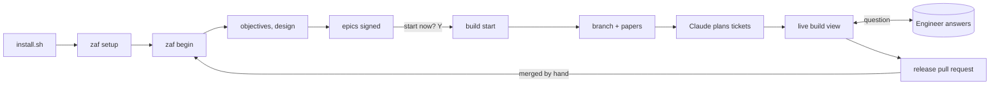

# Release 0.5.2 design: a stranger installs zaf and knows what to type

2026-11-19 · The Designer, from the signed `scope.md` · **Draft until the Engineer signs it.**

## Summary

0.5.2 turns zaf's first hour into something a stranger can do alone. Six parts, each from the scope:

1. **One pasted command installs zaf.** A script, published with each release, checks the tools, asks where zaf goes, puts it on PATH and adds the teams plugin to Claude Code. It says what it will do and why first, and shows each step on one line.
2. **zaf's screens share one look.** A small screen kit in the CLI: `zaf` in bright magenta-pink, verbs and nouns in their own colours, anything waiting on the Engineer in lavender, steps drawn on one line each. Colour only in a terminal, never with `NO_COLOR`. The hub's "waits on you" squares turn the same purple (#201).
3. **`zaf setup` speaks to a stranger.** A plan first, plain-word questions, one line per step, and at the end only what failed, each with the command that fixes it and why.
4. **`zaf begin` guides the whole release, and zaf starts the build.** Four stages (objectives, design, epics, build) with where you are. When the last epic is signed, zaf asks to start the build. Starting it makes the integration branch (#167) and commits the release folder onto it (#196).
5. **`zaf spawn --watch` is one live view.** Epics with a bar, tickets with their stage in plain words, a question answerable right in the view. When the version is built, zaf opens the release pull request and names it; the person merges it on the forge.
6. **`zaf update` updates everything.** The binary, the teams plugin (yours, and the project's pinned pack) and the machine's actions. A plan first, a short "What is new", then each changed action with why, its diff and a question. It no longer needs `gh`.

#223 is already on `main` and ships with the tag; nothing to design.
**Moved to 0.5.3** on the Engineer's word: a clean machine has no jj, and a plain git repository passes setup and fails at the first ticket. "Flag this for 0.5.3. We are moving git adapter stuff to 0.5.3." Flagged as #229.

**No one-way door** in the code. The nearest is the install command itself: once it is in the README and in people's notes, its URL must keep working (see One-way doors).
**Five epics** (Q13), filed as #224 to #228: the screens and setup, the install script, begin and the build start, the live build view, and update.
**Questions for the Engineer: 14 (Q1 to Q14), all answered on 2026-11-19.** Q2 in the Engineer's own words (to 0.5.3); the other thirteen as pre-filled. Q14 came from the fresh challenge.

## What this builds on

The input is `scope.md` (signed 2026-11-19). 0.5.2 has no objectives document: the Engineer made it a small release ("Let's make it into a patch"). So the goals trace to the scope's bullets, and the five mocks in `mocks/` are the reference for how each screen reads and moves.

| Goal | From the scope | Done when |
|---|---|---|
| G1 | "One setup, top to bottom", "configurable and added to PATH" | One pasted command on a clean Linux x86_64 or macOS Apple silicon machine installs zaf in the folder the person picks, puts it on PATH and adds the teams plugin. |
| G2 | "The script says what it will do and why", "Do not flood the CLI" | Before changing anything, the script lists its steps with why and asks. Each step is one line, redrawn in place. A tool's own output shows only when it failed. |
| G3 | "Colour calls the eye", `zaf` magenta-pink, waiting lavender | The five screens of the scope use the same colours for the same things. No colour when the output is not a terminal or `NO_COLOR` is set. The hub's question squares are the CLI's purple. |
| G4 | "The first line says what zaf stands for", "driving any AI agent", "teaches the first steps" | The script's first line is "zaf: Zuri's Amazing Framework". Its last lines are the three commands to start, plus `hub`, `status` and `help`. |
| G5 | "`zaf setup` speaks to a stranger" | As the setup mock: plan, explained questions, one line per step, only failures with the fixing command and why, and on green the next command. |
| G6 | "`zaf begin` guides the release" | As the begin mock: four stages with where you are, what each Claude Code session is for and how to leave it, signing, then the epics to read and sign and the command that starts the build. |
| G7 | "`zaf spawn --watch` shows the build as one live view" | As the spawn mock: one view redrawn in place, a question answered in it, Ctrl-C keeps the work, and the end names the release pull request and the next `zaf begin`. |
| G8 | "`zaf update` updates everything" | As the update mock: plan, "What is new" with the link, each action it would overwrite with why, its diff and a question, the old copy kept. |
| G9 | #167, #196, #201 | The build start makes the integration branch and commits the release folder; the hub's question squares are purple. |

**Done when** (the scope's): one pasted command on a clean Linux or macOS machine installs zaf, puts it on PATH and adds the teams plugin, and `zaf setup` in a project then ends green, with no Claude session opened along the way. Until 0.5.3, "ends green" includes installing jj, which setup names with its fix (Q2, Q3).

**Out**, carried from the scope: agents other than Claude Code, Windows, renaming the docs' "Zuri's AI Framework", and everything of 0.6.0 (the Jira and zabo boards, signing and design where the project says).
Also out:
- **The git adapter and the jj check, now 0.5.3's** (Q2, the Engineer, 2026-11-19; #229).
- **A better UI beyond the five screens.** Colour stays on the scope's five screens; `status`, `doctor` and error lines keep their plain text. 0.6.1 has the better UI (the Engineer, 2026-11-18).
- **zaf tagging a release** (Q14).

## Questions for the Engineer

Each question has options, the first marked as Claude's pick, then **Claude's answer** with its evidence.

**The Engineer (2026-11-19):** Q2 as quoted under it. Every other question as its pre-filled pick ("(Recommended)" chosen for each), so each of those picks is the ruling.

### The install script

**Q1. Where does the script live, and what is the one command?**
- (a) **(Recommended)** A file of each release, with that release's version written in: `curl -fsSL https://github.com/ProgrammingCheetah/ways/releases/latest/download/install.sh | sh`.
- (b) `install.sh` at the root of `main`, fetched from raw.githubusercontent.com, which then asks GitHub's API for the newest `zaf-v*` release.
- (c) Both.

**Claude's answer:** (a). GitHub documents `/releases/latest/download/<asset-name>` as a direct link to the latest release's file (docs.github.com, "Linking to releases"). "Latest" is the newest release that is neither a pre-release nor a draft (REST docs, "Get the latest release"). The script then knows its own version and needs no JSON parsing in `sh`, and it always matches the archives beside it. (b) has to parse JSON without `jq` and uses one of the 60 API calls an hour GitHub allows a machine with no token (REST docs, "Rate limits"). The archives are on GitHub and the repository is public (`gh repo view`: PUBLIC). Forgejo is not reachable for a stranger.

**Q2. A clean machine has no jj, and every manifest zaf writes requires it. What does 0.5.2 do?**
Today `zaf setup` writes `[vcs] kind = "jj"` and `[requires] jj` for every project (`zaf/src/app/init.rs:309-327, 414, 424`). Tickets' workspaces are made with jj (`plugins/teams/actions/workspace-open:112`). Nothing checks that the project folder is a jj repository, so a plain git repo passes setup and fails at the first ticket.
- (a) **(Recommended)** The script checks jj beside git and Claude Code. When jj is missing it says how to get it and why, and still installs zaf. `zaf setup` gains a check that the folder is a jj repository, whose fix is `jj git init --colocate`.
- (b) The script installs jj too.
- (c) Only `zaf setup` reports it, as a missing tool.

**Claude's answer:** (a). The approved install mock says "nothing is installed for you" on the check row, so (b) goes against it. (c) leaves a plain git repo passing setup and failing halfway.

**The Engineer (2026-11-19):** "Flag this for 0.5.3. We are moving git adapter stuff to 0.5.3." So 0.5.2 changes nothing here: the script checks git and Claude Code as the mock shows, and setup reports a missing jj as it reports any missing tool, with Q3's fix line. The repository check and the git adapter are 0.5.3's.

### The screens and setup

**Q3. What does setup's fix line say for a missing tool?**
- (a) **(Recommended)** A short table in zaf for the tools it knows (git, jj, gh, claude, node, npm) gives why zaf needs each and its install page. Sign-in problems give a command (`gh auth login`, or `export FORGEJO_TOKEN=…`). A tool zaf does not know says "install `<tool>`: your `.zaf.toml` asks for it".
- (b) A package-manager command per system (`brew install jj`, `apt install …`).
- (c) Just "install `<tool>`".

**Claude's answer:** (a). The scope asks for "the command that fixes it and why". (b) is wrong on many machines: a package missing from one distribution, a Mac with no Homebrew. The install pages are named in the table when built and checked then; none is asserted here. The why comes from what zaf does with the tool ("zaf opens pull requests through gh", the setup mock).

**Q4. Where do a release's papers live by default?** The approved begin mock shows `.zaf/releases/0.1.0/objectives.md`. zaf's default today is `.teams/releases/{version}` (`zaf/src/manifest/sections.rs:298-299`), set by `[release] folder`.
- (a) **(Recommended)** Keep `.teams/releases/{version}`. The mock's path was only an illustration.
- (b) Make `.zaf/releases/{version}` the default and add `!releases/` to `.zaf/.gitignore`'s allow-list.

**Claude's answer:** (a). dapple, zabo and ways keep the default. A new default would make `zaf begin` find their papers missing and ask for objectives again (`zaf/src/app/release.rs:37-43, 158-170`). `.zaf/` also ignores everything not on its allow-list (`zaf/src/app/setup.rs:44-52`), so the papers would silently stay out of git until the list changes.

### `zaf begin`, the build start and the end

**Q5. Where does zaf ask to start the build, and who makes the integration branch (#167)?**
- (a) **(Recommended)** `zaf epic sign` asks when it signs the last unsigned epic of a version ("Every epic of 0.1.0 is signed. Start the build now? [Y/n]"). `zaf begin` asks the same when it finds every epic signed. Yes starts the build in that terminal. The build start, shared by `zaf spawn --watch` and the hub's "Start the watch", makes the integration branch when it is missing, with one line saying so.
- (b) Only `zaf begin` asks.
- (c) Nothing asks: the person types `zaf spawn --watch`, which makes the branch.

**Claude's answer:** (a). The Engineer on #167: "ask the user if they should run what you just did". The last signature is that moment. Typing the build command, or pressing the hub's button, is already the person asking, so the branch is made there without a second question. The begin mock still names the command for someone who signs later. No check today tells that every epic of a version is signed (`signed()` is per epic, `zaf/src/domain/epic.rs:212-217`), so a new one is added.

**Q6. What gets committed when the build starts (#196)?**
- (a) **(Recommended)** The whole release folder, once its objectives (or scope) and design are signed: one commit on the integration branch, made by a new pack action, without moving the working copy.
- (b) Only the signed documents.
- (c) `zaf begin` commits each document to the default branch when it is signed.

**Claude's answer:** (a). The tasks cite more than the signed documents: 0.5.2's own scope names `mocks/` as "the reference for how each screen reads and moves". The branch does not exist while objectives are signed (#196's first open point), and the build start is the first moment it does. (c) writes to the default branch, which a work forge may protect. #196's other two points are settled by this: the release folder stays out of the design source, as ruled on #194 for 0.5.1, and tasks read it by path from the branch. A document edited after it was signed refuses the start (Part E), so tasks never read an unsigned design.

**Q7. What happens when every ticket of the version is merged?** Nothing opens a release pull request today. The tick's `release` step is not built (`zaf/src/app/spawn/tick.rs:23-24`), and the release instance opens it by hand ("no verb does it yet", `plugins/teams/agents/release.md:96`).
- (a) **(Recommended)** The scheduler runs a new pack action, `release-open <version>`, which opens or finds the pull request from the integration branch to the default branch. The view names it and the next `zaf begin`, and the watch ends with exit 0. With no terminal, or in the hub, the scheduler opens it the same way, says so, and keeps running as today.
- (b) The view names the command that opens it (`zaf do release-open 0.1.0`).
- (c) No pull request: the view says the version is built and names the next `zaf begin`.

**Claude's answer:** (a). The scope says the end "names the release pull request to review", so one has to exist. Opening a pull request is reversible and is what the release instance does by hand today. Ending the watch only in a terminal keeps the hub's watch and any unattended scheduler as they are.

**Q14. How does a stranger ship a built version?** (from the challenge) Nothing tags a version today, and the manifest zaf writes has no `[release] tag`, so "next version" read from tags alone would stay 0.1.0 for ever.
- (a) **(Recommended)** They merge the pull request by hand on the forge. zaf tags nothing in 0.5.2. "Next version" is the minor after the highest of the release tags and the release folders, worked out in one place for setup, begin and the view.
- (b) zaf tags the version once the pull request is merged (a new pack action), and the view says so.
- (c) The tick runs the release instance (reviews, musts, the tag) before it names the pull request.

**Claude's answer:** (a). The scope stops at "names the release pull request to review". (c) is the tick's unbuilt `release` step, far more than a patch. (b) is small but is a new rule about what a version is, better set with 0.5.3's git work. A release folder is the one trace every version leaves, so counting it keeps "next" right with no tag.

### `zaf update`

**Q8. Where does `zaf update` read the releases?**
- (a) **(Recommended)** GitHub's public API and download links, over `curl`, with no `gh`. When `GITHUB_TOKEN` is set it is sent, never printed or logged.
- (b) Through `gh`, as today.

**Claude's answer:** (a). Today it runs `gh release list` and `gh release download` (`zaf/src/adapters/github/releases.rs:37-60`). A Forgejo project's manifest does not require `gh` (`zaf/src/app/init.rs:324-327`), so a stranger on Forgejo, or at work, may not have it. zaf already reaches Forgejo through `curl` (`zaf/src/adapters/forgejo/api.rs:20`). An update makes two or three calls, well inside 60 an hour; the token covers an office that shares one address.

**Q9. Where does "What is new" come from?**
- (a) **(Recommended)** The release commit's message becomes the release notes on GitHub. It gains a short section, `What is new`, of up to five lines for someone who uses zaf, which the release instance writes. `zaf update` shows that section for each release it skips, newest first, then the link. With no such section it shows the message's first line.
- (b) The first line of each release's message, then the link.
- (c) Only the link.

**Claude's answer:** (a). The release message already is a changelog (`zaf 0.5.1: …` and its sections, commit 191583df). Today the notes on GitHub are only "Full Changelog" plus a link, because the workflow uses `--generate-notes` (`.github/workflows/zaf-release.yml:89`). The detailed sections are for the Engineer, not a stranger, so a short section on top keeps the screen to the mock's three lines.

**Q10. What does "update the teams plugin" cover?** Two copies of the pack matter. Your own Claude Code runs the design session from its plugin (`plugins/teams/actions/design:38-39`). Each project's profiles install the pack at the project's `[pack] tag`, and refuse when Claude installs another version, since "Claude Code offers no version pin" (`zaf/src/app/profile/mod.rs:502-515`). So updating your plugin alone changes nothing zaf's instances run.
- (a) **(Recommended)** `zaf update` updates your Claude Code's plugin. Run inside a project whose `[pack] tag` is now behind, it also shows the one-line change to `.zaf.toml`, asks, and on yes rewrites that line and regenerates the profiles.
- (b) Your plugin only. `zaf setup` offers to raise a project's tag.
- (c) Your plugin and every project on `~/.zaf/projects.toml`.

**Claude's answer:** (a). It is what "update everything" means where the person stands, and it changes a committed file only in the project they are in, after showing it. (c) edits other repositories' committed files from wherever the command runs. (b) leaves `zaf update` short of "everything". Today a stale tag shows only as a worksheet step ("Make the pack and the manifest's `[pack]` agree", `zaf/src/app/setup.rs` `worksheet`).

**Q11. Where does an action's "why" come from?** The update mock shows "will be replaced. Why: it now waits for the checks before it merges."
- (a) **(Recommended)** A plain comment, `# changed: <why>`, on the line right after the action's `# zaf` block, written by whoever changes the action. `zaf update` shows it when the installed copy does not have that line; with none it says "Why: not said; see the difference".
- (b) No why; the difference is the why.

**Claude's answer:** (a). It must be a plain comment, not a `# zaf changed:` key. zaf refuses any `# zaf` key it does not know ("unknown key", `zaf/src/app/actions/metadata.rs:421`), and the pack moves on `main` while a machine may still run zaf 0.5.1. It goes after the block, not inside it: the block ends at the first line that is not a `# zaf` line (`metadata.rs:235-238`), so a comment inside would turn the keys below it into body.

### The hub and the epics

**Q12. Which purple for "waits on you" (#201)?**
- (a) **(Recommended)** `#8b5cf6` in the light theme and `#af87ff` in the dark one (the CLI's lavender, colour 141). The bounce stays, so the state is never told by colour alone.
- (b) `#af87ff` in both themes.
- (c) A pinker purple, `#a855f7` light and `#c084fc` dark.

**Claude's answer:** (a). The dark one is the CLI's lavender, as the scope asks: "the CLI and the hub mean the same thing by it". On a white page `#af87ff` reaches about 2.7 to 1 against the background and `#8b5cf6` about 4.2 to 1 (arithmetic from the sRGB formula, done twice, not measured on screen). 3 to 1 is the usual floor for a shape you must see (WCAG 2.1 1.4.11, from memory). That a purple can look blue to someone who does not see red is also from memory; either way the bounce stays. (c) moves away from blue but no longer matches the CLI.

**Q13. How many epics?**
- (a) **(Recommended)** Five: **the screens and setup** (the kit, setup and the hub's purple), **the install script** (the script, the release workflow, the README), **begin and the build start** (#167, #196), **the live build view**, and **update**.
- (b) Four: begin and the view together.
- (c) Three: install with update, screens with setup, begin with the view.

**Claude's answer:** (a). Each is one thing the Engineer can sign alone, and about five tasks each. The kit comes first: begin, the view and update draw with it. The install script needs nothing else and runs beside the kit. Begin and the view both change the scheduler's start, so they go one after the other.

## The design

<b>Part A. The screen kit: modules and interfaces</b>

**Today.** The CLI prints plain lines. It has no colour anywhere: no escape codes, no `NO_COLOR`, no colour crate in `zaf/Cargo.toml`. Only `zaf hub` redraws, on the alternate screen (`zaf/src/cli/hub.rs:635`, size from `stty size` at 641-644). The one terminal test is `this_terminal()`: stdin and stdout both a terminal (`zaf/src/cli/do_action.rs:167-175`).

**After.**

| Id | Module (file) | Change |
|---|---|---|
| M1 | The screen (`zaf/src/cli/screen.rs`, new) | Turns a meaning into its terminal code and redraws one line in place. Colour is on only when stdout is a terminal, `NO_COLOR` is unset or empty ("when present and not an empty string", no-color.org) and `TERM` is not `dumb` (a convention, not checked here). Redraw needs a terminal and `TERM` not `dumb`. The word `zaf` takes its colour only as a whole word naming the program, never inside a path such as `~/.zaf`. |
| M2 | Words on a screen (`zaf/src/domain/screen.rs`, new) | The words a screen shows and what each means, with no codes: a meaning (I1), a plan row (verb, noun, why), a step's end, a fix (problem, command, why). Domain shapes, so the app builds them and the CLI draws them. |
| M3 | Step reports (`zaf/src/app/steps.rs`, new) | The port through which setup and update say a step started and how it ended. The CLI's adapter draws a spinner on the step's line and replaces it with ✓ or ✗; with no terminal it prints the final line only. (Not `progress`: `zaf progress` is already a verb, `zaf/src/cli/progress.rs`.) |

**Interfaces.**
- **I1** In the domain, `enum Meaning { Program, Verb, Noun, Done, Failed, Waiting, Dim, Bold }`. In the CLI, its codes, from the mocks: Program `1;38;5;201`, Verb `1;36`, Noun `33`, Done `32`, Failed `31`, Waiting `1;38;5;141`, Dim `2`, Bold `1`.
- **I2** `struct Screen { colour: bool, live: bool, rows: u16, columns: u16 }` with `Screen::detect()`, `paint(Meaning, &str) -> String` and `program(&str) -> String` (colours each whole word `zaf`). Tests build `Screen { colour: false, live: false, .. }` and compare plain text.
- **I3** `PlanRow { verb: Verb, noun: Text, why: Text }`, `Fix { problem: Text, command: Option<Command>, why: Text }`, `StepEnd { Done(Text), Failed(Text) }`, with newtypes per the house rule.
- **I4** `trait StepReport { fn started(&mut self, row: usize); fn ended(&mut self, row: usize, end: &StepEnd); }`. The terminal adapter animates on a small thread between the two calls, at the mocks' 80 ms.
- **Questions on a terminal** go through one helper: `ask_yes(prompt, default: Yes | No) -> bool`. Enter takes the default; closed input takes No whatever the default, so a pipe never agrees to anything.

**Unchanged.** `--json` output. With no terminal, the words stay the same with no colour and no redraw. Nothing is asked of a run with `ZAF_INSTANCE` set. Verbs other than the five screens keep their plain output (see Out).

<b>Part B. <code>zaf setup</code> for a stranger: modules and interfaces</b>

**Today.** Setup asks init's questions with no explanation (`zaf/src/app/init.rs:379-409`), then prints the profile lines, the actions lines, every doctor line and a worksheet ending "Tell me: the output of `zaf doctor`" (`zaf/src/app/setup.rs:310-321`; `zaf/src/cli/setup.rs:200-216`).

**After.** In a terminal it reads as the setup mock.

| Id | Module (file) | Change |
|---|---|---|
| M4 | Setup's plan (`zaf/src/app/setup.rs`) | `plan()` says what this run will do, worked out from what is there: "Ask n questions" and "Write .zaf.toml" only with no manifest, "Make" only for what is missing, then "Install the standard actions" and "Check your tools and access". The steps then run through the step report (M3). "Continue? [Y/n]" is asked only when the plan writes something; a re-run that only checks asks nothing. The question comes before anything is written, `ZAF.toml`'s move and the homes included, so "Nothing changed" on `n` is true. |
| M5 | Init's questions (`zaf/src/app/init.rs`) | Each question has a label, one line on what it means, and its default, as the mock words them. A Forgejo origin asks five, the fifth being the forge's address (`init.rs:387-403`), and the board's question is worded for its kind (GitHub issues, Forgejo issues). The answers and the manifest written are unchanged. |
| M6 | The fixes (`zaf/src/app/setup/fixes.rs`, new) | Every failing check becomes a `Fix`: a missing or old tool (Q3's table), a board or forge that will not answer (the board's and forge's own checks, with `gh auth login` or the token's variable), a stale pack, a folder. It replaces the worksheet's `Step`. |
| M8 | Setup's screen (`zaf/src/cli/setup.rs`) | Draws the plan, the question, init's questions, one line per step, then the fixes ("Fix it, then run `zaf setup` again") or, on green, "zaf is set up here. Next:" and `zaf begin --version <next>`. |
| M9 | The next version (`zaf/src/app/release.rs`) | `next_version(root, manifest)`: the minor after the highest of the tags matching `[release] tag` and the release folders that exist; 0.1.0 with neither (Q14). The one place setup, begin and the view ask. |

M7 (a jj-repository check) is gone: 0.5.3's (Q2).

**Unchanged.** What setup does, its exit codes, the replacement question for a differing action (#149, `[y/N]`), and the run with no terminal (nothing asked). The doctor table stays in `zaf doctor`; setup shows it only through the fixes.

<b>Part C. The hub's purple (#201): modules</b>

| Id | Module (file) | Change |
|---|---|---|
| M10 | The hub's colours (`zaf/web/src/app.css`) | `--sq-question` becomes `#8b5cf6` in the light theme and `#af87ff` in the dark one (lines 10 and 26 today, `#f0d93a` and `#f5e050`). The glow (line 508) follows the variable. The bounce stays. |
| M11 | The words (`zaf/web/src/EpicLine.svelte`, `QuestionPrompt.svelte`, `app.css`, `EpicLine.test.js`, the docs) | "yellow" becomes "purple" in comments and test names (`EpicLine.svelte:16, 107`, `QuestionPrompt.svelte:2`, `app.css:685`, `EpicLine.test.js:242, 540, 552, 608`). |
| M12 | The build (`zaf/web/dist/`) | Rebuilt and committed with the source. |

<b>Part D. The install script: modules and interfaces</b>

**Today.** Nine hand steps in the README (`README.md:28-64`): check Claude Code and git, add the marketplace, install the plugin, download and unpack an archive by hand, put it on PATH, run setup twice, start Claude. The release workflow publishes `zaf-v<v>-<target>.tar.gz` and its `.sha256` for `x86_64-unknown-linux-musl` and `aarch64-apple-darwin` (`.github/workflows/zaf-release.yml:51-63`).

**After.** The script reads as the install mock: the first line, the question for the folder, the five steps with why, "Continue? [Y/n]", a line per step, the closing commands.

| Id | Module (file) | Change |
|---|---|---|
| M13 | The script (`zaf/install.sh`, new) | POSIX `sh`, every line inside functions and one call on the last line, `main "$@" || exit 1`, so a download cut short runs nothing (rustup's way). Its steps: (1) check `git`, `curl`, `tar`, a sum tool and `claude --version` at 2.1.296 or later (the team brief's need, `plugins/teams/README.md:44`; `claude --version` prints `2.1.328 (Claude Code)` here); (2) download this release's archive and its `.sha256` into a temporary folder, check the sum (`sha256sum` or `shasum -a 256`, as `zaf update` does), unpack, run `zaf --version`; (3) put it in the folder: written beside the old one and renamed over it, so a running zaf is never written into (as `zaf/src/app/update.rs:148`); (4) add the folder to PATH when it is not there; (5) add the marketplace when `claude plugin marketplace list` lacks `ways`, then `claude plugin install teams@ways`, or `claude plugin update teams@ways` when it is there; (6) print the commands. |
| M14 | The release workflows (`.github/workflows/zaf-release.yml`, `.forgejo/workflows/zaf-release.yml`) | Each release carries `install.sh` with `ZAF_VERSION=<v>` written into it. The notes are the tag's commit message (Q9), read from a checkout of the tag, which the `release` job does not have today. The release is made as a draft and published only once every file is up, so "latest" never points at a release with no `install.sh` (today the files go up after the release exists, lines 88-91). The Forgejo workflow builds its JSON by hand, so the message is encoded by a JSON tool, not pasted. |
| M15 | The README (`README.md`) | "Install on a new computer" becomes the one command and what it does. The hand steps stay below it, under "By hand". |
| M16 | The script's tests (`zaf/tests/install_script.rs`, new) | Run the script with fake `uname`, `sysctl`, `git`, `claude` and archives on PATH and a local download folder; check each step, each refusal, a second run, and a script cut in half. |

**Interfaces.**
- **I5** `install.sh [--dir <folder>] [--yes]`; through the pipe, `curl -fsSL … | sh -s -- --yes`. Questions read `/dev/tty`, since `curl … | sh` gives the script no stdin of its own. With no terminal at all it refuses unless `--yes`, which takes every default. Both are rustup's way (`rustup-init.sh`, fetched 2026-11-19).
- **I6** PATH, from `$SHELL`'s name. zsh: `${ZDOTDIR:-$HOME}/.zshrc`. bash on Linux: `~/.bashrc`. bash on macOS: the first that exists of `~/.bash_profile`, `~/.bash_login`, `~/.profile`, else a new `~/.bash_profile`, so the file bash already reads stays the one it reads. fish: `~/.config/fish/conf.d/zaf.fish` with `fish_add_path`. Anything else: `~/.profile`. One block, marked `# added by zaf's install script`, written once. The plan's row names the file before anything is asked. bash's order of files and fish's `conf.d` are from memory, checked when built.
- **I7** `ZAF_INSTALL_FROM`: a folder or URL the archives are read from instead of GitHub, for the tests. It changes only where files come from; the sum is still checked.
- **Platform.** `uname -s` and `uname -m`: Linux x86_64 and Darwin arm64. On Darwin, `uname -m` says x86_64 under Rosetta, so `sysctl hw.optional.arm64` is asked too (rustup's check). Anything else stops before changing anything: "zaf is released for Linux x86_64 and macOS Apple silicon. On <os> <arch>, build it: `cargo install --git https://github.com/ProgrammingCheetah/ways --tag zaf-v<v> --locked zaf`", the words `zaf update` already uses.
- **The folder.** A typed `~` is expanded. A folder that does not exist is made after "Continue". One that cannot be written stops before anything changes, naming `~/.local/bin` as the default; the script never uses `sudo`.
- **Stops before changing anything** for any failed check of step 1: no git, no curl, tar or sum tool, no Claude Code, or one older than 2.1.296, each with its fix. jj is not checked (Q2).
- **Quiet.** A tool's output goes to a log in the temporary folder. A failed step shows ✗, its last five lines and the log's path, which is then kept. A step already done says so on its line (a marketplace already added, a folder already on PATH).
- **Again.** Run twice, the script replaces zaf in the folder, adds nothing twice, and when another `zaf` comes first on PATH it says which.
- That `claude plugin marketplace list` and `claude plugin update` exist on 2.1.296 is not checked; they are on 2.1.328. The minimum rises if they do not.

**Unchanged.** `zaf update` stays the way to update; the script is for the first install, and repairs one.

<b>Part E. <code>zaf begin</code> and the build start (#167, #196): modules and interfaces</b>

**Today.** `zaf begin` knows two stages, objectives and design (`zaf/src/app/release.rs:78-85, 158-170`). It prints nothing of its own before a Claude session, asks `Sign <path>? [y/N]` after one (`zaf/src/app/begin.rs:321`), and with nothing due lists the version's epics with `zaf epic sign <n>` under each unsigned one (`zaf/src/cli/begin.rs:219-231`). Once a version's epics are closed, design reads as due again (`release.rs:166`). No check tells that every epic of a version is signed. Nothing makes the integration branch (`base-up` only moves one already on the remote, `.zaf/actions/base-up:3, 65-68`, and is ways' own). Nothing commits the papers. An epic has no tickets when it is signed: planning makes them after (`zaf/src/domain/epic.rs:173-176`).

**After.**

| Id | Module (file) | Change |
|---|---|---|
| M17 | Release stages (`zaf/src/app/release.rs`) | Stages worked out on each read: objectives, design (as today), epics while an epic of the version is unsigned, build once every epic of the version is signed, and built once every epic of the version is done, open or closed. A built version no longer reads as needing its design. `all_signed(version)` is the new check. |
| M18 | Begin's screen (`zaf/src/cli/begin.rs`) | As the begin mock: the stages with ✓ and ▸; before a session, what it is for and how to leave it (`/exit`), then "Open it? [Y/n]"; after, "✓ <file> written" and "Sign it? It says what you mean, and an edit later unsigns it. [y/N]"; at epics, each epic with `zaf epic show <n>` and `zaf epic sign <n>`, then the build command; at build, Q5's question; at built, the release pull request and `zaf begin --version <next>`. An unsigned epic shows no ticket count, since it has none yet ("zaf plans its tickets once you sign it"), unlike the mock's "6 tickets". |
| M19 | Epic signing (`zaf/src/cli/epic.rs`) | After a signature, at a terminal and outside an instance: when every epic of that epic's version is now signed, Q5's question. Yes hands the terminal to `zaf spawn --watch --version <v>`. |
| M20 | The build start (`zaf/src/app/build.rs`, new) | Checks, then acts. It refuses, changing nothing, when the release folder's objectives (or scope) or design is unsigned, or edited since it was signed ("run `zaf begin --version <v>` to sign it again"), or when the project has no remote. Then it runs `base-open <version>` and `papers-commit <version>`. The scheduler's start calls it once, before its first tick, for `zaf spawn --watch` and the hub's watch alike. A refusal stops the start with its words: in a terminal on screen, in the hub as the watch's `409` and a problem on the project. |
| M21 | `base-open` (`plugins/teams/actions/base-open`, new) | Makes `[branches] integration` for the version at the remote's default branch and pushes it. One already on the remote is handed back if it carries the default branch, and refused if it does not. A local branch of that name that the remote lacks is refused, never pushed. The working copy never moves. |
| M22 | `papers-commit` (`plugins/teams/actions/papers-commit`, new) | Puts the release folder's files, as the working copy holds them, in one commit on the integration branch and pushes it. Nothing new to commit is quiet. The working copy never moves. |

**Interfaces.**
- **I8** `pub fn stage(root, manifest, board, version) -> Stage` with `enum Stage { Objectives, Design, Epics(Vec<EpicToSign>), Build, Built }`.
- **I9** `pub fn start(composition, version) -> Result<Started, BuildError>`, where `Started` says whether the branch was made and the papers committed, for the one line each prints.
- **I10** Both actions are `target`-less, `zaf`-run, with `ZAF_VERSION`, `ZAF_BASE` and `ZAF_RELEASE_DIR` set (the last from `PhaseEnv` today, `zaf/src/app/actions/run.rs:303-339`, now also set here). Exit 0 done, 1 refused, 2 a backend failed. The default branch is jj's `trunk()`. With no remote, `trunk()` falls back to the root commit, which is why M20 refuses first. That jj resolves `trunk()` to the remote's default branch, and the flags that commit into a revision without editing it, are checked when built (unverified here).

**Unchanged.** Who signs: zaf, after asking. The release folder's path (Q4). The design source stays `docs/` (#194's ruling).

**For 0.5.2's own build.** It is built by zaf 0.5.1, which has none of this. The integration branch and the committed papers are made by hand once more, as for 0.5.1.

<b>Part F. The live build view: modules and interfaces</b>

**Today.** `zaf spawn --watch` is the scheduler in the foreground. It streams each tick's text block with `println!` and never redraws, whatever the output is (`zaf/src/cli/scheduler.rs:47-132`; `zaf/src/cli/spawn.rs:532-567`). It stops on Ctrl-C after the current tick (`zaf/src/app/schedule/scheduler.rs:199-204`), restarts itself on a new binary (206-236), and never reads stdin. It does not end when a version is done. The hub already builds most of what a view needs: per epic its title, stage, done and total, its own question, and per task its title, state, phase, blockers and question (`zaf/src/app/hub/state.rs:36-134`, `gather_project` at 329-435). It does not say which version an epic belongs to.

**After.** In a terminal, the view of the spawn mock. With no terminal, or with `--json`, the stream as today.

| Id | Module (file) | Change |
|---|---|---|
| M23 | The view's frame (`zaf/src/app/spawn/view.rs`, new) | A pure function from the hub's `ProjectState`, the version, the time, a spinner step and the window's size to the lines of one frame: the header ("zaf is building 0.1.0", n of m tickets merged, minutes), the Ctrl-C line, then each epic of the version with its bar ■□ and n/m, and each ticket with ✓ merged, its stage in plain words, what it waits on, or "? question for you". Other open epics the tick also runs come after, dimmed. Every line is cut to the width, so none wraps, and the frame to the height: an epic whose tickets are all merged takes one line, then "and n more". |
| M24 | Stage words (`zaf/src/app/spawn/view.rs`) | Before an epic has tickets, its stage: signed "Claude plans the tickets", planned "Claude checks the plan". Then the default phases: implement "Claude writes the code", ci "your check command runs on its pull request", review "Claude reviews the change", merge "merging". A project's own phase shows its name. Waits come from the task's blockers ("waits on #21"); a ticket not started reads "queued". |
| M25 | The view (`zaf/src/cli/watch_view.rs`, new) | Redraws the frame in place on the normal screen (up over the last frame, clear, draw), so the end stays in the scrollback. It reads the window's size before each frame (`stty size`, as the hub does). It gathers the project's state after each tick and on each hub report, and only animates in between. Typed keys are not echoed except while asking (`stty -echo`, as the hub does), and the terminal is put back on every way out. The tick's text block and its warnings go to `.zaf/logs/scheduler.log`; a failed tick shows one line in the view. |
| M26 | Answering (`zaf/src/cli/watch_view.rs`) | When a question is open, on a ticket or on an epic, the view stops redrawing, shows it in full with its own number and how to answer from elsewhere (`zaf board ruling <question> '…'`, which takes the question's number, `zaf/src/cli/board.rs:241-244`), and reads one line. The ticks go on meanwhile. An answer is ruled as `zaf board ruling` does it and asks for a tick; only an empty answer is refused, since the gap check is for text a shell ate (`zaf/src/domain/ruling.rs:64-72`) and this one went through none. An empty line skips it: it stays marked "? question for you" and is not asked again in this run. Several are asked one at a time, oldest first. |
| M27 | The end (`zaf/src/app/spawn/`, `plugins/teams/actions/release-open`, new) | When every epic of the version is done, the scheduler runs `release-open <version>` once (Q7). The view prints the end: "zaf built 0.1.0: n tickets merged in t", "merge pull request #n on the forge to ship it" (Q14), and `zaf begin --version <next>` (M9); then the watch ends with 0. |
| M35 | The hub's epic (`zaf/src/app/hub/state.rs`) | `EpicState` gains `release: Option<String>`, the version its `Release:` line names, so the view picks the version's epics. The hub's JSON gains the field. |

**Ways out.**
- **Ctrl-C** while a question is asked puts the terminal back and ends as Ctrl-C does today, after the tick, with one more line: "#n stays open: answer it with `zaf board ruling n '…'`".
- **A restart on a new zaf** (scheduler.rs:206-236) waits while a question is being asked. Otherwise the view puts the terminal back before the restart, and the new view draws again; a skipped question is asked again there.

**Interfaces.**
- **I11** `pub fn frame(state: &ProjectState, version: &Version, now: SystemTime, spin: u8, size: (u16, u16)) -> Vec<Line>`, where a `Line` is a list of `(Meaning, Text)` pieces (I1, in the domain), so the app picks the meaning and the CLI the codes.
- **I12** `release-open <version>`: hands back the pull request's number and link; one already open is handed back. Exit 0, 1 refused (no integration branch), 2 a backend failed.
- **Input** is a thread reading whole lines from stdin while asking. Ctrl-C reaches the scheduler as today.

**Unchanged.** The scheduler's loop, its lock and its ticks. The hub's watch draws nothing new.

<b>Part G. <code>zaf update</code> updates everything: modules and interfaces</b>

**Today.** `zaf update` reads the newest `zaf-v*` tag through `gh`, downloads the archive and its sum, checks both, and renames the new binary over the running one (`zaf/src/app/update.rs:120-170`). It prints one line. It updates nothing else.

**After.** As the update mock: the plan, "What is new" with the link, "Continue? [Y/n]", a line per step, then each changed action with why, its diff and "Replace it? [Y/n]". Unlike setup's `[y/N]`, Enter replaces here, as in the approved mock: the person asked for the update. Each run checks all of it, so a run after "nothing to do" for the binary still updates the plugin and the actions.

| Id | Module (file) | Change |
|---|---|---|
| M28 | Public releases (`zaf/src/adapters/github/public_releases.rs`, new) | The `Releases` port over `curl` and GitHub's public API: the releases with their tags and notes, and the files of a release from its download links. `GITHUB_TOKEN` is sent when set, never printed or logged (Q8). No network or a refusal (a used-up limit) changes nothing and says which. |
| M29 | The update's plan (`zaf/src/app/update.rs`) | Worked out before the question, changing nothing: the binary (old → new); your plugin (installed → the version in `main`'s `plugins/teams/.claude-plugin/plugin.json`, read over `curl`, so the marketplace is not updated before you agree); the machine's actions (k of n differ from the pack's); and in a project with a stale `[pack] tag`, the tag (Q10). "What is new" for each skipped release (Q9). |
| M30 | The steps (`zaf/src/cli/update.rs`) | The running zaf does every step it knows. Updating from 0.5.1 does only the binary, since 0.5.1's update is the one running; the next `zaf update` does the rest. No hidden flag hands over to the new binary, so no later zaf has to keep one. |
| M31 | The plugin step (`zaf/src/app/update.rs`) | `claude plugin marketplace update ways`, then `claude plugin update teams@ways`, in your Claude home (both subcommands in `claude plugin --help`, Claude Code 2.1.328). Not installed: added as the script does. No `claude`: that row fails and the others go on. A marketplace added from a local folder (the method's own computer, `README.md:64`) is left as it is, and the row says so. |
| M32 | The actions step (`zaf/src/app/setup.rs`, shared) | Setup's install of the pack's actions, fed from your Claude home's installed teams plugin (`profile::installed_path`, `zaf/src/app/profile/mod.rs:685-696`) instead of a project's profile. Before each diff, the why (Q11). Old copies go to `~/.zaf/actions-replaced/`, as #149 does. |
| M33 | The project's pack (`zaf/src/app/update.rs`) | Q10 (a): shows the one changed line of `.zaf.toml`, asks, rewrites only that line, then regenerates the profiles (`profile::init_with`). A project with `[pack] path` (ways) is skipped, and the row says so. |
| M34 | The release message (`plugins/teams/agents/release.md`) | The release instance writes the `What is new` section on top of the message. |

**Interfaces.**
- **I13** `Releases` gains `fn notes(&self, tag: &str) -> Result<Option<String>, PortError>`.
- **I14** `pub fn what_is_new(notes: &str) -> Vec<Text>`: the lines under `What is new` up to the next blank line, at most five; else the first line.
- **I15** `pub fn why(installed: &str, pack: &str) -> Option<Text>`: the pack's `# changed:` line when the installed copy lacks it.
- The closing line says what happens to what runs: a running `zaf spawn --watch` moves to the new zaf between two ticks, as today; running instances finish on the old one.

**Unchanged.** `zaf update --check`, `--json`, the sum and `--version` checks, and the rename that leaves the old binary on any failure.

## Diagram

`zaf update` stands apart: it can run at any time and touches only zaf, the plugin, the machine's actions and the project's pinned pack.

## Data shapes

- **Stored:** nothing new in zaf's state. Every stage, plan, "all signed" and "next version" is worked out on read.
- **On the board:** nothing new.
- **Manifest:** no new key (Q4). `zaf update` may rewrite a project's `[pack] tag` line (Q10).
- **The hub's JSON:** an epic gains `release` (M35), an addition.
- **The pack:** three new actions (`base-open`, `papers-commit`, `release-open`), and a plain `# changed:` comment after an action's `# zaf` block (Q11).
- **A release on GitHub:** a new file, `install.sh`, and notes that are the release commit's message with a `What is new` section.
- **The person's machine:** one marked block in one shell file (I6). The install folder they chose.

## One-way doors

None in the code. Two things to keep in mind:
- **The install command's URL.** Once it is in the README and in people's notes, `releases/latest/download/install.sh` must keep working, so every later release has to publish an `install.sh`. Cheap to keep, awkward to move.
- **Branches pushed and pull requests opened by zaf** (Q5, Q7). Both are reversible on the forge; they are the first things zaf does to the forge without an instance in between.

## Epics

| Id | Epic | Holds | Size |
|---|---|---|---|
| E1 (#224) | **zaf's screens and setup** | Part A (M1 to M3, I1 to I4), Part B (M4 to M6, M8, M9), Part C (M10 to M12), with their documents. Closes #201. | about 6 tasks |
| E2 (#225) | **The install script** | Part D (M13 to M16, I5 to I7). | about 4 tasks |
| E3 (#226) | **`zaf begin` and the build start** | Part E (M17 to M22, I8 to I10). Closes #167 and #196. | about 5 tasks |
| E4 (#227) | **The live build view** | Part F (M23 to M27, M35, I11, I12). | about 5 tasks |
| E5 (#228) | **`zaf update` updates everything** | Part G (M28 to M34, I13 to I15). | about 5 tasks |

Each epic body opens with `Release: 0.5.2` (from `zaf epic file`) and carries the Engineer's words, its parts as numbered sections, Out and Done when. Order: E1 and E2 first, side by side. E3, E4 and E5 draw with E1's kit. E4 waits on E3, since both change the scheduler's start. E5's "What is new" reads the notes E2's workflow change writes; before that release it shows each message's first line.

## Risks

- **A clean machine still needs more than one command.** jj until 0.5.3 (Q2), and for a GitHub project `gh` signed in. Setup names each, with its fix.
- **The sum guards a broken download, not a forged release.** The `.sha256` comes from the same release as the archive. Whoever can publish a release can change both.
- **"Latest" on GitHub is by date.** A patch to an older line, released after a newer one, would become "latest". zaf releases one line at a time today; `gh release create --latest` would pin it (flag not checked).
- **Lavender on a light terminal** is pale (about 2.7 to 1 on white). Bold helps; a terminal's theme decides the rest.
- **The view and slow boards.** The view gathers the project's state after each tick, one more round of board reads every few minutes. Fine for ways' Forgejo; not measured on GitHub's API limits.
- **The begin mock's "6 tickets"** cannot show at signing, since an epic has no tickets yet (M18). The screen differs from the approved mock there.
- **0.5.2 is built by 0.5.1**, so its own integration branch and papers are made by hand (Part E).

<b>Evidence</b>

- The mocks: `mocks/install-mock.sh`, `setup-mock.sh`, `begin-mock.sh`, `spawn-mock.sh`, `update-mock.sh`; the colours in I1 are theirs.
- The issues: #167 (base-open and asking, the Engineer's words), #196 (papers uncommitted; #194's ruling), #201 (purple, the open points).
- GitHub: `/releases/latest/download/<asset-name>` (docs.github.com, "Linking to releases"); latest = "the most recent non-prerelease, non-draft release, sorted by the created_at attribute" (REST, "Get the latest release"); "The primary rate limit for unauthenticated requests is 60 requests per hour" (REST, "Rate limits"). Fetched 2026-11-19.
- `NO_COLOR`: "when present and not an empty string (regardless of its value), prevents the addition of ANSI color" (no-color.org, fetched 2026-11-19).
- rustup-init.sh (raw.githubusercontent.com/rust-lang/rustup, fetched 2026-11-19): connects `/dev/tty` when stdin is not a terminal and refuses without `-y` when stdout is not one either; asks `sysctl hw.optional.arm64` on Darwin when `uname -m` says x86_64; ends with `main "$@" || exit 1`.
- Claude Code's plugin commands: `claude plugin --help` and `claude plugin marketplace --help` on 2.1.328 list `install`, `update`, `list`, `marketplace add`, `list`, `update`.
- The repository is public (`gh repo view ProgrammingCheetah/ways`); its releases hold the two archives and their sums (`gh release view zaf-v0.5.1`).
- The machine-action metadata refuses unknown keys (`zaf/src/app/actions/metadata.rs:421`), and its block ends at the first line that is not a `# zaf` line (`:235-238`).
- The profile pins: `zaf/src/app/profile/mod.rs:490-515`; ways' `[pack] path`, dapple's `[pack] tag = "teams-v2.1.2"` (`~/code/dapple/.zaf.toml:73-74`).
- Contrast figures in Q12: arithmetic from the sRGB relative-luminance formula, done by Claude and again by the challenger, not by a tool.
- A fresh Designer challenged this document on 2026-11-19: 18 findings and 7 proposed questions. It checked 38 citations; 4 were wrong and are fixed here (`workspace-open:112`, `init.rs:379-409`, `hub.rs:635`, the 4.2 figure). One proposed question became Q14 (shipping). The other six were taken as details with the pick it proposed: what the view says while planning runs (M24), a question freezes the view (M26), an unwritable folder refuses with no `sudo` and a missing or old Claude Code stops the script (Part D), colour only on the five screens (Out), `GITHUB_TOKEN` when set (Q8, M28). Every other finding is taken in: the epic's version in the hub (M35), the script's failure cases (Part D), the build start's refusals (M20), the workflows' draft and checkout (M14), the comment's place (Q11), the questions' count (M5), the view's terminal handling (M25, Ways out), the stage after build (M17), the ask on re-run (M4), the update's own failures (M28, M31, M33), the domain holding the meanings (I1, I11), the port's name (M3), the diagram's planning and shipping steps, and E5's wait on E2. The hidden flag for update (`--finish`) was dropped rather than listed as a door (M30).

