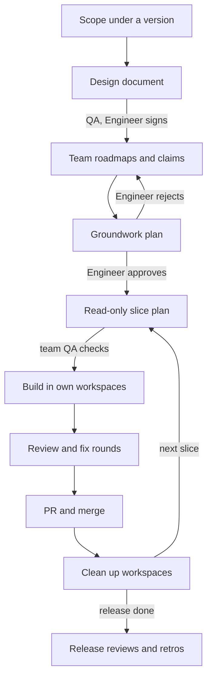

# teams

One Claude session is the **Orchestrator**, the tech lead. Teams of background agents (**Spawns**) plan, build and review: each team has a standing, named lead and QA, and its programmers are short-lived, spawned by a build lead for one task and ended when it's done. **The Engineer** is the Product Owner and decides every domain fork. The Orchestrator is the Engineer's single interface: agents never reach the Engineer directly.

| Part | What it is |
|---|---|
| `skills/orchestrate/` | `/teams:orchestrate`: the way of working, loaded by the Orchestrator every session, plus `first-run.md`, `planner-check.md` and the templates it hands out |
| `skills/` (eight more) | Routines that also work alone: see **Skills** below |
| `agents/` | The five lanes: `teams:planner`, `teams:designer`, `teams:builder`, `teams:myth`, `teams:machinery` |

No scripts, no hooks, no programs: it runs the same on Linux, macOS and Windows (Claude Code 2.1.292 or later, which passes `effort` on Agent calls). It needs no other plugin. The `nodes` plugin is offered at setup with an opt-out; the agent board is used when its tools are present.

## The lifecycle



Every arrow into a new box hands a document to **freshly spawned** agents: leads' and QA's names and roles persist, context doesn't. Documents that reach the Engineer (the design document, the Groundwork) carry their QA's challenges and the author's resolutions. A slice plan reaches the Engineer only for a domain fork, a one-way door, or a change to a signed document. A fix or small change outside a release starts at the slice plan, on the same bar; its PR into main is still the Engineer's review.

**Why programmers are short-lived.** The Orchestrator is cheap; recreating context is not. A resumed Spawn re-reads its whole context, and one that waits past the prompt cache's lifetime rewrites its whole cache when it wakes. So a programmer gets one task (a slice or part of one) and a narrow brief, is spawned only when it can start now, and ends at its report. A fix round goes to a fresh programmer briefed with the findings, the branch and its diff, in the same workspace. A blocked piece ends the programmer with the question in its report. Leads and QA keep the clean-context-per-phase rule.

**Leads spawn programmers.** After a slice plan is saved, the Orchestrator spawns a fresh **build lead** (`teams:designer`) with the saved plan (the planner lead is read-only and can't spawn), its workspaces and branches, and a programmer budget: how many programmers it may run at once, sized so the lanes stay inside the teams file's Limits. A lane is a build lead, its running programmers and its QA. The build lead splits the slice into tasks, spawns one programmer per task (`teams:builder`, or `teams:myth` at subsystem scale) with a narrow brief, running independent tasks in parallel, one per workspace at a time. It reviews their reports, checks the gate and pushes, then reports to the Orchestrator. It picks each programmer's model: `sonnet` for a fully specified, bounded, non-security task; `opus` for security-nature work (always), an ambiguous or cross-cutting task, the Myth, and a task whose Sonnet attempt still has must-fixes after two fix rounds. A fix round is a fresh build lead with the plan, the findings, the branch and workspace, spawning fresh programmers. Reviews stay with the Orchestrator, independent of the lead. Spawn and hand-back between a build lead and its programmers is the only Spawn-to-Spawn traffic.

## Skills

Besides `/teams:orchestrate`, eight routines (they absorb what a separate `ship` pack was to hold). Each works on its own, without the Orchestrator and without a teams file: it reads the teams file when there is one, else detects what it needs (CI config, default branch, git or jj) and asks once for the rest. The read-only ones change nothing.

| Skill | What it does | Lifecycle |
|---|---|---|
| `/teams:my-queue` | The Engineer's queue (`<docs>/queue.md`, open questions, live PRs) as Ready, Incoming, Questions, Waiting and Optional tables, each row with an ID, weight and blocker. Read-only. | the Engineer asks what's theirs |
| `/teams:catch-me-up` | A short briefing from the queue, the release folder, rulings and VCS history: where things stand, why, what's missing, what's next. Read-only. | after a gap |
| `/teams:cleanup` | Reports every git worktree or jj workspace with its merge evidence and cleanliness; after one confirmation, runs `Repository › teardown` and removes only the merged, remote-gone, clean ones; keeps and reports the rest. | step 9 |
| `/teams:critique` | Two passes over a diff: the right thing built (against the plan or ticket), built right (against the codebase's own patterns); fix or ask per finding. | the review loop before a PR |
| `/teams:document` | Doc comments on what changed, in each language's style and placement. Docs only. | definition of done |
| `/teams:prepare-pr` | One branch to an open PR: commits, rebase, the gate, a leased push, the PR body, the review bot. Never merges. | step 8 |
| `/teams:address-comments` | Triages a PR's review comments (fix, decline, propose, escalate), routes fixes through the lanes, re-gates and pushes. Security comments are never declined. | step 8 |
| `/teams:retrospective` | A retro grounded in commits, PRs and reviews: a team's, in `retro-template.md`'s shape, or Claude's own over a time range. Saved in `<docs>/retros/`. | retrospectives |

## How the roles reach the main session

On its first run in a project, `/teams:orchestrate` writes one line into the project's `CLAUDE.md` (the Engineer's own repo) or `CLAUDE.local.md` (anyone else's, kept out of git):

```
**Way of working: teams.** The main session is the Orchestrator: it loads the `teams:orchestrate` skill at the start of each session and again after compaction, and follows it. A Spawn (any subagent) skips this line and follows its brief.
```

Claude Code loads that file into every session in the project and re-reads the project's CLAUDE.md after compaction, so the Orchestrator reloads the skill when it needs to. Nothing to paste, no process to run, and the line names the skill rather than a file path, so plugin updates never break it. Projects without the line are untouched.

Why not the alternatives: a `SessionStart` hook needs a shell or an executable on the work computer and would fire in every project; a forced output style collides with any other plugin's forced style (the first one loaded wins) and overrides the Engineer's own; the plugin `agent` setting replaces Claude Code's whole system prompt in every session; a skill description alone leaves loading to chance.

## Lanes

| Lane | Agent | Effort | Writes | Used for |
|---|---|---|---|---|
| plan | `teams:planner` | xhigh | nothing | per-slice plans and their QA |
| judgment | `teams:designer` | xhigh | documents, its own workspace | release documents, roadmaps, the Groundwork, QA of code and documents, reviews, every security review |
| build | `teams:builder` | high | its own workspace | approved plans to green code |
| subsystem | `teams:myth` | high | its own workspace | long, fully specified subsystem builds |
| glue | `teams:machinery` | medium | workspaces, branches | creating workspaces, removing merged ones with `/teams:cleanup`, committing release documents from a docs workspace |

Every agent file says Opus. **Only programmers may run on Sonnet** (the build lead's choice per task, or a teams-file pin); **security-nature work and every other role are always Opus.** To change a lane's effort in one project, set it in the teams file's **Lanes** table; it's passed on each Agent call. A Model there applies only to programmers: a build or subsystem Model pins every programmer to it (e.g. Opus only), except security-nature tasks, which stay on Opus.

**How read-only the planner is.** Plugin agents ignore `permissionMode`, so the planner can't be put in plan mode. Its `tools` allowlist is `Read`, `Glob`, `Grep`, `Bash`, `PowerShell`, `WebFetch`, `WebSearch`, `ToolSearch` (which loads the web tools where they're deferred) and `SubagentHandback` (which delivers its report). LSP is left out: a language server can write cache files into the planning workspace and trip the check below. Every editing tool, every way to start or steer another agent (except through the shell), MCP tools and any tool Claude Code adds later are out. One hole stays, by the Engineer's choice: the shell can still write, and it's kept for git history and read-only commands. So every planner run (lead, QA, each resume) happens in a clean planning workspace at the base branch's tip, never the Engineer's checkout, and the Orchestrator runs `skills/orchestrate/planner-check.md` around it: a marker file before, then a list of everything in the workspace modified after the marker (outside `.git` and `.jj`, ignored files and deletions included), plus the workspace's own VCS status. It works in git, in jj secondary workspaces that have no `.git`, and in bash, zsh or PowerShell. Any change stops the slice, the Engineer sees what changed, and the plan isn't saved. Writes outside that workspace aren't detected.

## The teams file

This pack's whole configuration for a project is **`.claude/TEAMS.md`**: settings, the teams and opt-outs, in fixed sections the Orchestrator reads by name. `/teams:orchestrate` offers to create it on first run (`skills/orchestrate/first-run.md`), asking once with every answer pre-filled from what it detects, and never regenerates it over your edits. `.claude/TEAMS.yaml` and `.claude/TEAMS.toml` work too, with the same settings under snake_case keys (`skills/orchestrate/teams-file.toml`); if more than one exists the Orchestrator warns and reads Markdown, then YAML, then TOML. Before writing anything, first run adds `.claude/settings.local.json` to the repo's exclude file (`git rev-parse --git-path info/exclude`), and in a repo that isn't the Engineer's also the teams file, `CLAUDE.local.md` and the docs folder.

First run also hands the Engineer one worksheet that saves `.claude/settings.local.json` with the workspaces folder in `permissions.additionalDirectories` and allow rules for the gate and the VCS commands, so background Spawns don't stall on prompts. The skill never edits settings itself.

| Section › key | Default | Meaning |
|---|---|---|
| Repository › owner | engineer | `engineer`: the file and docs are committed and the pointer goes in `CLAUDE.md`. `others`: all stay out of git |
| Repository › docs | `.teams` | where `queue.md`, `releases/<version>/` and `retros/` live; outside `.claude/`, whose writes always prompt |
| Repository › style | — | the project's style rules, read by every agent |
| Repository › decisions | — | where the project records decisions |
| Repository › vcs | git | `git` or `jj` |
| Repository › main | main | the default branch, never pushed to directly |
| Repository › workspaces | `../{repo}-workspaces` | one workspace per branch, named after it, reused by its reviewers and fix rounds, plus planning workspaces |
| Repository › teardown | — | commands run inside a workspace before `/teams:cleanup` removes it (`{name}`, `{path}`), e.g. tearing down its containers |
| Repository › gate | — | exactly what CI runs, all of it; before a slice's first push and before QA |
| Repository › light gate | — | for restacks and fix rounds; CI stays the enforcement |
| Branches › strategy | integration | `integration` (a feature branch cut at main's tip, fed by slice PRs, its own PR opening when every slice is in) or `trunk` (one PR per slice into main) |
| Branches › integration, slice | `feature/{slug}`, `feature/{slug}-{n}-{part}` | branch name patterns |
| Branches › engineer reviews | main | PRs into these are the Engineer's to review and merge; the Orchestrator merges the rest once QA passes |
| Branches › merge slice, merge main | merge, squash | merge method for each kind of PR |
| Tracker › kind, project, commit format | none, —, — | the issue tracker and commit title convention |
| Release › version format | `v{version}` | e.g. `{stage}-v{version}` |
| Release › stages | — | e.g. pre-alpha, alpha, beta, release |
| Release › documents | design | the release document set: one design document, or e.g. pdd, tdd, plan |
| Release › format | markdown | `markdown` with Mermaid, or `typst` |
| Lanes (table) | — | per-lane effort overrides; a build or subsystem Model pins programmers (never security-nature tasks or any other role) |
| Limits › max lanes | 2 | lanes running at once (a lead, its running programmers and QA); a documents-only lane counts; each build lead's programmer budget fits inside |
| Limits › small lanes | 4 | allowed when every lane is one or two agents on a short slice |
| Limits › internal after | 3 | new retrospectives that wake the internal team |
| Reviews › release reviews | on | compliance, architecture and security at each release's end |
| Reviews › security triggers | authentication; authorization and permissions; sessions, tokens, secrets and keys; cryptography; untrusted input; trust boundaries; network egress; personal data storage | a slice touching one gets a security review; first run fits them to the project |
| Reviews › compliance triggers | personal data; payments; accessibility; a new dependency's license | a slice touching one calls compliance in early; first run fits them to the project |
| Reviews › bot | — | a review bot requested on PRs into the Engineer's branches |
| Reviews › comment prefix | `Claude:` | starts every comment posted through the Engineer's accounts |
| Teams (table) | internal, compliance, architects, security, plus the project's teams | mission, owned paths, named lead and QA, review teams' reviewers; programmers aren't listed |
| Shared ground | — | files no team owns, touched one Spawn at a time |
| Opt-outs | — | the internal team, nodes or release reviews, each with the date and the Engineer's words |

## Optional integrations

- **nodes** (`nodes@ways` and its `nodes` binary, 0.7.0 or later): setup offers it, pre-selected yes in the Engineer's own repos and no in anyone else's, where a tree would be local-only and live only in the Orchestrator's checkout. When in use, every brief has its Spawn run `nodes --root <dir> chain <path>` for the paths it owns and touches before reading code there: its own workspace for a committed tree, which writing Spawns may also update; the Orchestrator's checkout, read-only, for a local-only tree, which the Orchestrator re-charts after each merge. Teams runs plain `nodes` from PATH and doesn't read the nodes pack's `NODE.toml`. Declining records the opt-out and everything else runs the same.
- **The agent board** (its own plugin): used only when its tools are present. Writing Spawns register, teams may run roadmap rounds and claims on the board, and locks cover shared ground.

## Updating

From the marketplace: `claude plugin marketplace update ways`, then `claude plugin update teams@ways`, then start a new session. A marketplace added from a local folder loads this plugin in place, so edits apply at the next session or after `/reload-plugins`.
