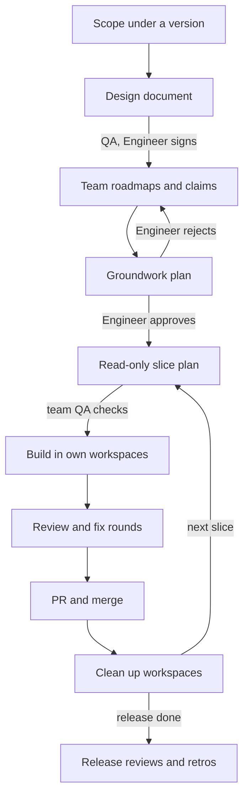

# teams

One Claude session is the **Orchestrator**, the tech lead. Standing teams of background agents (**Spawns**: a lead, programmers and a QA each) plan, build and review. **The Engineer** is the Product Owner and decides every domain fork. The Orchestrator is the Engineer's single interface: agents never reach the Engineer directly.

| Part | What it is |
|---|---|
| `skills/orchestrate/` | `/teams:orchestrate`: the whole way of working, read by the Orchestrator every session, plus the templates it hands out |
| `agents/` | The five lanes: `teams:planner`, `teams:designer`, `teams:builder`, `teams:myth`, `teams:machinery` |

No scripts, no hooks, no programs: it runs the same on Linux, macOS and Windows. It needs no other plugin; the `nodes` plugin and the agent board are optional and detected when present.

## The lifecycle



Every arrow into a new box hands a document to **freshly spawned** agents: names and roles persist, context doesn't. Documents that reach the Engineer (the design document, the Groundwork) carry their QA's challenges and the author's resolutions. Slice plans reach the Engineer only for a domain fork or a one-way door. A fix or small change outside a release starts at the slice plan, and with no Groundwork behind it, that plan goes to the Engineer.

## How the roles reach the main session

On its first run in a project, `/teams:orchestrate` writes one line into the project's `CLAUDE.md` (the Engineer's own repo) or `CLAUDE.local.md` (anyone else's, kept out of git):

```
**Way of working: teams.** The main session is the Orchestrator: before its first reply it loads the `teams:orchestrate` skill and follows it. A Spawn (any subagent) skips this line and follows its brief.
```

Claude Code loads that file into every session in the project and re-reads it after compaction, so the Orchestrator loads the skill at the start of each session. Nothing to paste, no process to run, and it names the skill rather than a file path, so plugin updates never break it. Projects without the line are untouched.

Why not the alternatives: a `SessionStart` hook needs a shell or an executable on the work computer and would fire in every project; a forced output style collides with any other plugin's forced style (the first one loaded wins) and overrides the Engineer's own; the plugin `agent` setting replaces Claude Code's whole system prompt in every session; a skill description alone leaves loading to chance.

## Lanes

| Lane | Agent | Effort | Writes | Used for |
|---|---|---|---|---|
| plan | `teams:planner` | xhigh | nothing | per-slice plans and their QA |
| judgment | `teams:designer` | xhigh | documents, its own workspace | design documents, roadmaps, the Groundwork, QA, reviews, every security review |
| build | `teams:builder` | high | its own workspace | approved plans to green code |
| subsystem | `teams:myth` | high | its own workspace | long, fully specified subsystem builds |
| glue | `teams:machinery` | medium | its own workspace | deterministic housekeeping |

All run Opus. To change a lane's model or effort in one project, set it in the teams file's **Lanes** table; the Orchestrator passes it on each Agent call.

**How read-only the planner is.** Plugin agents ignore `permissionMode`, so the planner can't be put in plan mode. Its `disallowedTools` removes every editing tool (`Edit`, `Write`, `NotebookEdit`) and every way to hand work to something that writes (`Agent`, `Workflow`, `SendMessage`, `Monitor`, `EnterWorktree`, the artifact tools). That matches Claude Code's built-in Plan agent, which also keeps the shell. Two holes remain, documented rather than closed: the shell (`Bash`, or `PowerShell` on Windows) can still write, because on macOS and Linux it is also how Claude searches; and MCP tools stay available. The planner is told it is read-only in plan mode's own words, your permission mode still governs its shell commands, and the Orchestrator checks that the checkout's VCS status is unchanged after every planner returns.

## The teams file

This pack's whole configuration for a project is **`.claude/TEAMS.md`**: settings, the roster and opt-outs, in fixed sections the Orchestrator reads by name. `/teams:orchestrate` offers to create it on first run, asking once with every answer pre-filled from what it detects, and never regenerates it over your edits. `.claude/TEAMS.yaml` and `.claude/TEAMS.toml` work too, with the same keys (`skills/orchestrate/teams-file.toml`); if more than one exists the Orchestrator warns and reads Markdown, then YAML, then TOML. In a repo that isn't the Engineer's, the file, `CLAUDE.local.md` and the docs folder go in `.git/info/exclude`.

| Section › key | Default | Meaning |
|---|---|---|
| Repository › owner | engineer | `engineer`: the file is committed and the pointer goes in `CLAUDE.md`. `others`: both stay out of git |
| Repository › docs | `.claude/teams` | where `queue.md`, `releases/<version>/` and `retros/` live |
| Repository › style | — | the project's style rules, read by every agent |
| Repository › decisions | — | where the project records decisions |
| Repository › vcs | git | `git` or `jj` |
| Repository › main | main | the default branch, never pushed to directly |
| Repository › workspaces | `../<repo>-workspaces` | one workspace per programmer, named after them |
| Repository › gate | — | exactly what CI runs, all of it |
| Repository › light gate | — | a lighter gate for restacks and fix rounds |
| Branches › strategy | integration | `integration` (a feature branch fed by slice PRs) or `trunk` (one PR per slice into main) |
| Branches › integration, slice | `feature/{slug}`, `feature/{slug}-{n}-{part}` | branch name patterns |
| Branches › engineer reviews | main | PRs into these are the Engineer's to review and merge; the Orchestrator merges the rest once QA passes |
| Branches › merge slice, merge main | merge, squash | merge method for each kind of PR |
| Tracker › kind, project, commit format | none, —, — | the issue tracker and commit title convention |
| Release › version format | `v{version}` | e.g. `{stage}-v{version}` |
| Release › stages | — | e.g. pre-alpha, alpha, beta, release |
| Release › documents | design | the release document set: one design document, or e.g. pdd, tdd, plan |
| Release › format | markdown | `markdown` with Mermaid, or `typst` |
| Lanes (table) | — | per-lane model and effort overrides |
| Limits › max lanes | 2 | lanes running at once; a documents-only lane counts |
| Limits › small lanes | 4 | allowed when every lane is one or two agents on a short slice |
| Limits › internal after | 3 | new retrospectives that wake the internal team |
| Reviews › release reviews | on | compliance, architecture and security at each release's end |
| Reviews › security triggers | authentication; sessions and tokens; trust boundaries; network egress; the private/public data boundary | a slice touching one gets a security review |
| Reviews › compliance triggers | personal data; age or adult content; copyright or takedowns; payments or tax; accessibility; a new dependency's license | a slice touching one calls compliance in early |
| Reviews › bot | — | a review bot requested on PRs into the Engineer's branches |
| Reviews › comment prefix | `Claude:` | starts every comment posted through the Engineer's accounts |
| Teams (table) | internal, compliance, architects, security, plus the project's teams | mission, owned paths, named lead, programmers, QA |
| Shared ground | — | files no team owns, touched one Spawn at a time |
| Opt-outs | — | the internal team, nodes or release reviews, each with the date and the Engineer's words |

## Optional integrations

- **nodes** (`nodes@ways` and its `nodes` binary): on unless opted out. Spawns run `nodes chain <path>` for the paths they own and touch before reading code there. Setup asks; declining records the opt-out and everything else runs the same.
- **The agent board** (its own plugin): used only when its tools are present. Spawns register, teams may run roadmap rounds and claims on the board, and locks cover shared ground.

## Updating

From the marketplace: `claude plugin marketplace update ways`, then `claude plugin update teams@ways`, then start a new session. A marketplace added from a local folder loads this plugin in place, so edits apply at the next session or after `/reload-plugins`.
