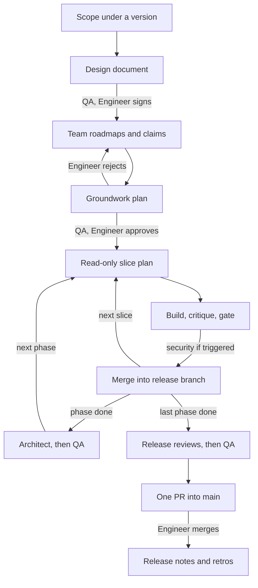

# teams

One Claude session is the **Orchestrator**, the tech lead. Teams of background agents (**Spawns**) plan, build and review: each team has a standing, named lead, and its programmers are short-lived, spawned by a build lead for one task and ended when it's done. A standing **QA** and the **architect** work beside the Orchestrator, at every milestone and at the release's end. **The Engineer** is the Product Owner and decides every domain fork. The Orchestrator is the Engineer's single interface: agents never reach the Engineer directly.

| Part | What it is |
|---|---|
| `skills/orchestrate/` | `/teams:orchestrate`: the way of working, loaded by the Orchestrator every session, plus `first-run.md`, `planner-check.md` and the templates it hands out |
| `skills/` (eight more) | Routines that also work alone: see **Skills** below |
| `agents/` | The five lanes: `teams:planner`, `teams:designer`, `teams:builder`, `teams:myth`, `teams:machinery` |

No scripts, no hooks, no programs: it runs the same on Linux, macOS and Windows (Claude Code 2.1.292 or later, which passes `effort` on Agent calls). It needs no other plugin. The `nodes` plugin is offered at setup with an opt-out; the agent board is used when its tools are present.

## The lifecycle



Every arrow into a new box hands a document to **freshly spawned** agents: names and roles persist, context doesn't. Documents that reach the Engineer (the design document, the Groundwork) carry the top-level QA's challenges and the author's resolutions. A slice plan reaches the Engineer only for a domain fork, a one-way door, or a change to a signed document. A fix or small change outside a release starts at the slice plan, on the same bar; its PR into main gets QA, then the Engineer's review.

**Why programmers are short-lived.** The Orchestrator is cheap; recreating context is not. A resumed Spawn re-reads its whole context, and one that waits past the prompt cache's lifetime rewrites its whole cache when it wakes. So a programmer gets one task (a slice or part of one) and a narrow brief, is spawned only when it can start now, and ends at its report. A fix round goes to a fresh programmer briefed with the findings, the branch and its diff, in the same workspace. A blocked piece ends the programmer with the question in its report. Leads and QA keep the clean-context-per-phase rule.

**Why QA is at the top.** QA stands beside the Orchestrator and the architect, not inside each team: it reviews what reaches the Engineer (the design document, the Groundwork, every PR into main) and each milestone's cumulative diff, starting from the architect's report. Per slice there's only the gate, the build lead's own critique of its diff before it pushes, and a security review when a trigger fires: security never waits for a milestone. A QA per slice re-read the release documents for every slice and saw one slice at a time; at the top it reads them once a milestone and sees how the slices fit. QA is fresh at each milestone and carries forward its log, not its context: a context resumed after the prompt cache expires is rewritten whole, and it would still hold reads of code that later fix rounds changed. Within a milestone it's resumed, to re-run its proofs. A release is a version scoped at the lifecycle's first step; off-cycle work covers the rest.

**Leads spawn programmers.** After a slice plan is saved, the Orchestrator spawns a fresh **build lead** (`teams:designer`) with the saved plan (the planner lead is read-only and can't spawn), its workspaces and branches, and a programmer budget: how many programmers it may run at once, sized so the lanes stay inside the teams file's Limits. A lane is a build lead and its running programmers. The build lead splits the slice into tasks, spawns one programmer per task (`teams:builder`, or `teams:myth` at subsystem scale) with a narrow brief, running independent tasks in parallel, one per workspace at a time. It reviews their reports, runs the critique on the slice diff and settles each finding, checks the gate and pushes, then reports to the Orchestrator. It picks each programmer's model: `sonnet` for a fully specified, bounded, non-security task; `opus` for security-nature work (always), an ambiguous or cross-cutting task, the Myth, and a task whose Sonnet attempt still has must-fixes after two fix rounds. A fix round is a fresh build lead with the plan, the findings, the branch and workspace, spawning fresh programmers. Security reviews and milestone QA stay with the Orchestrator, independent of the lead. Spawn and hand-back between a build lead and its programmers is the only Spawn-to-Spawn traffic.

## Skills

Besides `/teams:orchestrate`, eight routines (they absorb what a separate `ship` pack was to hold). Each works on its own, without the Orchestrator and without a teams file: it reads the teams file when there is one, else detects what it needs (CI config, default branch, git or jj) and asks once for the rest. The read-only ones change nothing.

| Skill | What it does | Lifecycle |
|---|---|---|
| `/teams:my-queue` | The Engineer's queue (`<docs>/queue.md`, open questions, live PRs) as Ready, Incoming, Questions, Waiting and Optional tables, each row with an ID, weight and blocker. Read-only. | the Engineer asks what's theirs |
| `/teams:catch-me-up` | A short briefing from the queue, the release folder, rulings and VCS history: where things stand, why, what's missing, what's next. Read-only. | after a gap |
| `/teams:cleanup` | Reports every git worktree or jj workspace with its merge evidence and cleanliness; after one confirmation, runs `Repository › teardown` and removes only the merged, remote-gone, clean ones; keeps and reports the rest. Without a teams file it only reports. | **Clean up** |
| `/teams:critique` | Two passes over a diff: the right thing built (against the plan or ticket), built right (against the codebase's own patterns); fix or ask per finding. | **Build**: the build lead's pass before it pushes |
| `/teams:document` | Doc comments on what changed, in each language's style and placement. Docs only. | definition of done |
| `/teams:prepare-pr` | One branch to an open PR: commits, the base merged in if behind (a rebase only where the project's own rules want one), the gate, a plain push that can't overwrite work, the PR body, the review bot. Never merges. In the lifecycle a `teams:machinery` Spawn runs it. | **Slice merge**, **Release end** |
| `/teams:address-comments` | Triages a PR's review comments (fix, decline, propose, escalate), routes fixes through the lanes, re-gates and pushes. Security comments are never declined. | **Release end**, and any PR into the Engineer's branches |
| `/teams:retrospective` | A retro grounded in commits, PRs and reviews: a team's, in `retro-template.md`'s shape, the top-level QA's milestone log (`qa <version> m<n>`), or Claude's own over a time range. Saved in `<docs>/retros/`. | retrospectives, **Milestone QA** |

## How the roles reach the main session

On its first run in a project, `/teams:orchestrate` writes one line into the project's `CLAUDE.md` (the Engineer's own repo) or `CLAUDE.local.md` (anyone else's, kept out of git):

```
**Way of working: teams.** The main session is the Orchestrator: it loads the `teams:orchestrate` skill at the start of each session and again after compaction, and follows it. A Spawn (any subagent) skips this line and follows its brief.
```

Claude Code loads that file into every session in the project and re-reads the project's CLAUDE.md after compaction, so the Orchestrator reloads the skill when it needs to. Nothing to paste, no process to run, and the line names the skill rather than a file path, so plugin updates never break it. Projects without the line are untouched.

Why not the alternatives: a `SessionStart` hook needs a shell or an executable on the work computer and would fire in every project; a forced output style collides with any other plugin's forced style (the first one loaded wins) and overrides the Engineer's own; the plugin `agent` setting replaces Claude Code's whole system prompt in every session; a skill description alone leaves loading to chance.

## Lanes

| Lane | Agent | Effort | Writes | Used for |
|---|---|---|---|---|
| plan | `teams:planner` | xhigh | nothing | per-slice plans |
| judgment | `teams:designer` | xhigh | documents, its own workspace | release documents, roadmaps, the Groundwork, build leads, the top-level QA and the architect, reviews, every security review |
| build | `teams:builder` | high | its own workspace | approved plans to green code |
| subsystem | `teams:myth` | high | its own workspace | long, fully specified subsystem builds |
| glue | `teams:machinery` | medium | workspaces, branches | creating workspaces, removing merged ones with `/teams:cleanup`, committing release documents from a docs workspace, opening PRs with `/teams:prepare-pr` |

Every agent file says Opus. **Only programmers may run on Sonnet** (the build lead's choice per task, or a teams-file pin); **security-nature work and every other role are always Opus.** To change a lane's effort in one project, set it in the teams file's **Lanes** table; it's passed on each Agent call. A Model there applies only to programmers: a build or subsystem Model pins every programmer to it (e.g. Opus only), except security-nature tasks, which stay on Opus.

**How read-only the planner is.** Plugin agents ignore `permissionMode`, so the planner can't be put in plan mode. Its `tools` allowlist is `Read`, `Glob`, `Grep`, `Bash`, `PowerShell`, `WebFetch`, `WebSearch`, `ToolSearch` (which loads the web tools where they're deferred) and `SubagentHandback` (which delivers its report). LSP is left out: a language server can write cache files into the planning workspace and trip the check below. Every editing tool, every way to start or steer another agent (except through the shell), MCP tools and any tool Claude Code adds later are out. One hole stays, by the Engineer's choice: the shell can still write, and it's kept for git history and read-only commands. So every planner run (lead, each resume, and a plan security challenge) happens in a clean planning workspace at the base branch's tip, never the Engineer's checkout, and the Orchestrator runs `skills/orchestrate/planner-check.md` around it: a marker file before, then a list of everything in the workspace modified after the marker (outside `.git` and `.jj`, ignored files and deletions included), plus the workspace's own VCS status. It works in git, in jj secondary workspaces that have no `.git`, and in bash, zsh or PowerShell. Any change stops the slice, the Engineer sees what changed, and the plan isn't saved. Writes outside that workspace aren't detected.

## The teams file

This pack's whole configuration for a project is **`.claude/TEAMS.md`**: settings, the teams and opt-outs, in fixed sections the Orchestrator reads by name. `/teams:orchestrate` offers to create it on first run (`skills/orchestrate/first-run.md`), asking once with every answer pre-filled from what it detects, and never regenerates it over your edits. `.claude/TEAMS.yaml` and `.claude/TEAMS.toml` work too, with the same settings under snake_case keys (`skills/orchestrate/teams-file.toml`); if more than one exists the Orchestrator warns and reads Markdown, then YAML, then TOML. Before writing anything, first run adds `.claude/settings.local.json` to the repo's exclude file (`git rev-parse --git-path info/exclude`), and in a repo that isn't the Engineer's also the teams file, `CLAUDE.local.md` and the docs folder.

First run also hands the Engineer one worksheet that saves `.claude/settings.local.json` with the workspaces folder in `permissions.additionalDirectories` and allow rules for the gate and the VCS commands. Unattended Spawns still need auto mode: every Spawn command starts `cd <workspace> &&`, and in Manual mode a `cd` followed by `git` asks for approval whatever the allow rules say, since git can run the hooks of the directory it moved into. Don't switch briefs to `git -C <path>` to avoid that: the deny rules below don't match that form. The worksheet allows no push. Every lifecycle push is plain: a branch that falls behind its base gets the base merged in, never rebased, so its history gains merge commits, and a squash merge into main keeps main linear. Tested on Claude Code 2.1.302 with no push rule, auto mode let those plain pushes and `jj git push -b` through, and blocked leased pushes as `[Git Destructive]`, which an allow rule doesn't settle in a `cd … &&` command. A push allow rule would also switch off the classifier's checks on what every push carries (secrets, sensitive files, private material bound for a public repo), since an allow rule resolves first. Where a project's own rules want rebased branches, they win, and its leased pushes may stall in auto mode for the Engineer to push. Deny rules then cover pushes that name `Repository › main` or an `engineer reviews` branch (the branch as a refspec, `+main`, `<src>:main`, `:main`, `refs/heads/main` in each of those forms, `--all`, `--branches`, `--mirror`; with jj, the bookmark by name, `--all` and `--tracked`); never `*main*`, which would block slice branches like `api/v0.2-1-domain`, and deny beats allow. Those rules are a speed bump, not a guard: they match the command as written, so `git -C <path> push`, a bare `git push` from main or a bare `jj git push` (it takes main along once main moved locally) gets past them. The real guard is the server's protection of main. First run checks that the server refuses a direct push, a force push and a deletion of main from the Engineer's account (GitHub: a ruleset with `pull_request`, `non_fast_forward` and `deletion` rules the account can't bypass, or classic protection with admins enforced) and, if it's missing, recommends turning it on with the exact `gh` command or the settings click path (in a repo that isn't the Engineer's, only a request to its owners, never the command, even for an admin); the skill never changes a setting itself, local or on the server. If protection stays off, that's recorded in Opt-outs. Protection stops pushes, not merges: an agent signed in to `gh` as the Engineer could still `gh pr merge` into main, so only the rule that PRs into `engineer reviews` branches are the Engineer's to merge stands there.

**Whose repo.** A repo is the Engineer's own when it has no remote, or its push remote's owner (`origin`, or the remote `git push` uses) is the Engineer's forge login (`gh api user --jq .login`; on another host, add `--hostname <host>`) or an organization listed in the environment variable `WAYS_OWN_ORGS` (comma-separated, spaces around the commas ignored, e.g. `example-org,another-org`; leave it unset where no organization is yours, as on a work computer). A fork counts by its parent's owner, never its own; when that can't be told, it isn't yours. Admin rights never count: on a work computer you may admin a team's shared repos, and those aren't yours. First run pre-fills `Repository › owner` with this test, and the nodes pack uses it too.

| Section › key | Default | Meaning |
|---|---|---|
| Repository › owner | engineer | `engineer`: the repo is yours by the test in "Whose repo" above; the file and docs are committed and the pointer goes in `CLAUDE.md`. `others`: all stay out of git |
| Repository › docs | `.teams` | where `queue.md`, `releases/<version>/` and `retros/` live; outside `.claude/`, whose writes always prompt |
| Repository › style | — | the project's style rules, read by every agent |
| Repository › decisions | — | where the project records decisions |
| Repository › config dir | `.` | root of this pack's configuration files, relative to the project root; each team's Config resolves against it |
| Repository › vcs | git | `git` or `jj` |
| Repository › main | main | the default branch, never pushed to directly |
| Repository › workspaces | `../{repo}-workspaces` | one workspace per branch, named after it, reused by its reviewers and fix rounds, plus planning workspaces |
| Repository › teardown | — | commands run inside a workspace before `/teams:cleanup` removes it (`{name}`, `{path}`), e.g. tearing down its containers |
| Repository › gate | — | exactly what CI runs, all of it; after the build lead's critique, before a slice's first push |
| Repository › light gate | — | for base merges and fix rounds; CI stays the enforcement |
| Branches › strategy | integration | `integration` (one branch per release, fed by slice PRs; one PR into main at release end) or `trunk` (a PR per slice into main, the Engineer's; milestone QA reviews what merged, and its fixes are new PRs) |
| Branches › integration, slice | `release/{release}`, `{team}/{release}-{n}-{part}` | branch name patterns (an off-cycle branch matches none); `{release}` is the version as `Release › version format` writes it, `{team}` the team's name with `/` as `-`; the integration branch is cut and pushed before slice 1 |
| Branches › fix | `{team}/{release}-m{n}-fix` | a milestone fix round's branch, merged into the integration branch like a slice |
| Branches › engineer reviews | main | PRs into these are the Engineer's to review and merge; the Orchestrator merges the rest (slice and fix PRs) once the slice checks pass and CI ran green |
| Branches › merge slice, merge main | merge, squash | merge method for each kind of PR; a squashed release PR is one commit on main |
| Tracker › kind, project, commit format | none, —, — | the issue tracker and commit title convention |
| Release › version format | `v{version}` | e.g. `{stage}-v{version}` |
| Release › stages | — | e.g. pre-alpha, alpha, beta, release |
| Release › documents | design | the release document set: one design document, or e.g. pdd, tdd, plan |
| Release › format | markdown | `markdown` with Mermaid, or `typst` |
| Lanes (table) | — | per-lane effort overrides; a build or subsystem Model pins programmers (never security-nature tasks or any other role) |
| Limits › max lanes | 2 | lanes running at once (a lead and its running programmers, or one reviewer); a documents-only lane counts; each build lead's programmer budget fits inside |
| Limits › small lanes | 4 | allowed when every lane is one or two agents on a short slice |
| Limits › internal after | 3 | new retrospectives that wake the internal team |
| Reviews › release reviews | on | compliance, architecture and security at each release's end, before the last milestone's QA |
| Reviews › security triggers | authentication; authorization and permissions; sessions, tokens, secrets and keys; cryptography; untrusted input; trust boundaries; network egress; personal data storage | a slice touching one gets a security review of its plan and code; first run fits them to the project |
| Reviews › compliance triggers | personal data; payments; accessibility; a new dependency's license | a slice touching one calls compliance in early; first run fits them to the project |
| Reviews › bot | — | a review bot requested on PRs into the Engineer's branches |
| Reviews › comment prefix | `Claude:` | starts every comment posted through the Engineer's accounts |
| Teams (table) | qa, internal, compliance, architects, security, plus the project's teams | mission, owned paths, a named lead (the qa row's is the top-level QA; the architects' is the architect), review teams' reviewers, and an optional config file (Config; `config_file` in TOML and YAML); programmers aren't listed |
| Shared ground | — | files no team owns, touched one Spawn at a time |
| Opt-outs | — | the internal team, nodes, release reviews or main's protection, each with the date and the Engineer's words |

**Team config files.** A team's Config names its own file, relative to `Repository › config dir`, in the teams file's format (`skills/orchestrate/team-config.md`, or `team-config.toml` for TOML and YAML): the team's Roles and the special instructions each must follow. Its sections default to the pack's: Every role (all the team's Spawns), then lead, build lead, programmer, security reviewer, release reviewer, top-level QA and architect; any other name is a free-form role for a special occasion, never an error, and the Orchestrator asks when it can't tell whose brief one covers, recording the answer. At every brief, the Orchestrator re-reads the files and pastes into the brief, verbatim, the Spawn's own team's Every role and role sections, plus, for a reviewer, its role's section from each team whose work it reviews; a build lead passes Every role and Programmer on to its programmers. The instructions add to a brief and never loosen the pack's rules: the Orchestrator leaves out one that would and asks you. A named file that's missing or unreadable stops that team's Spawns until it's fixed or the row is cleared. No agent edits these files; first run only writes the ones you name that don't exist yet.

## Optional integrations

- **nodes** (`nodes@ways` and its `nodes` binary, 0.7.0 or later): setup offers it, pre-selected yes in the Engineer's own repos and no in anyone else's, since the first chart is costly and there its settings and refs would stay local-only, in one checkout. When in use, every brief has its Spawn run `nodes --root <dir> chain <path>` for the paths it owns and touches before reading code there: its own workspace for a committed tree, which writing Spawns also update, the changes shipping in their PR; the Orchestrator's checkout, read-only, for a local-only tree, which the Orchestrator re-charts after each merge, recording the ref changes Spawns report. Teams runs plain `nodes` from PATH and doesn't read the nodes pack's `NODE.toml`. Declining records the opt-out and everything else runs the same.
- **The agent board** (its own plugin): used only when its tools are present. Writing Spawns register, teams may run roadmap rounds and claims on the board, and locks cover shared ground.

## Updating

From the marketplace: `claude plugin marketplace update ways`, then `claude plugin update teams@ways`, then start a new session. A marketplace added from a local folder loads this plugin in place, so edits apply at the next session or after `/reload-plugins`.
